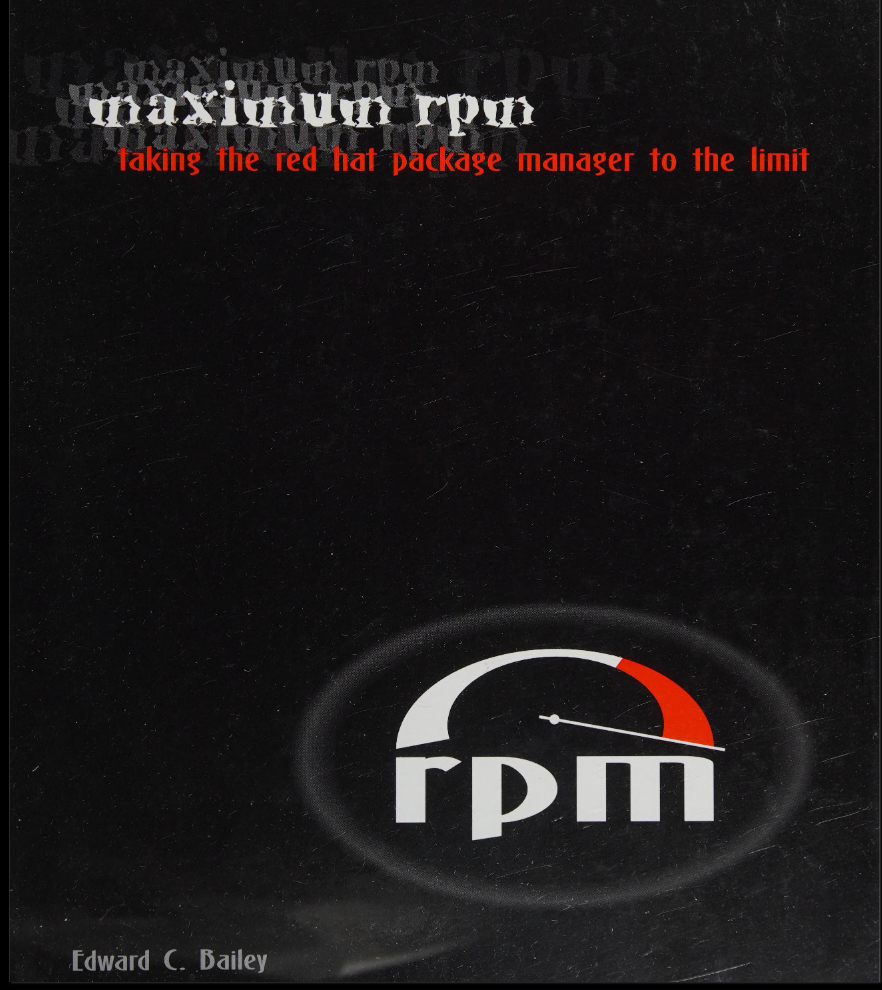
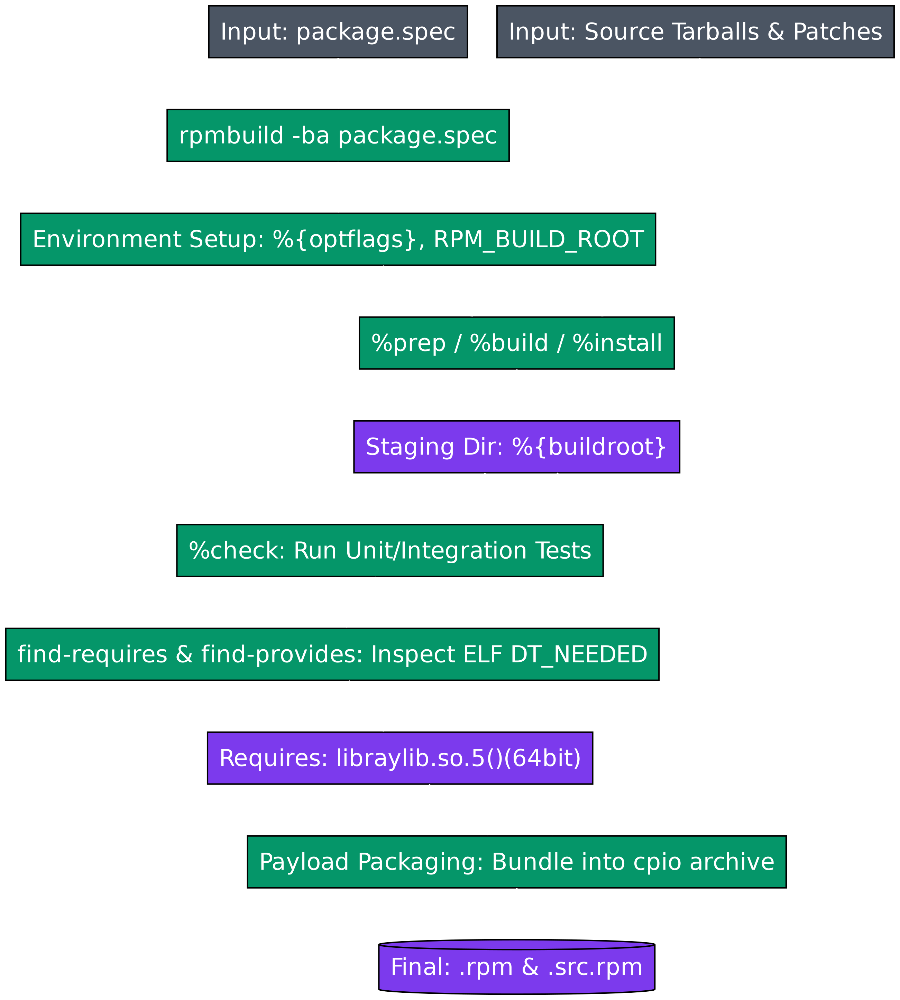
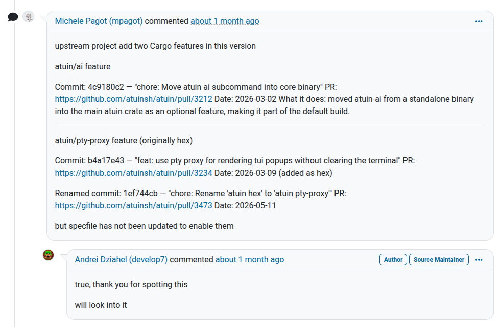
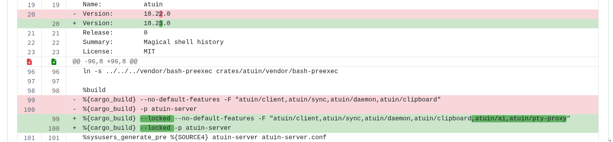
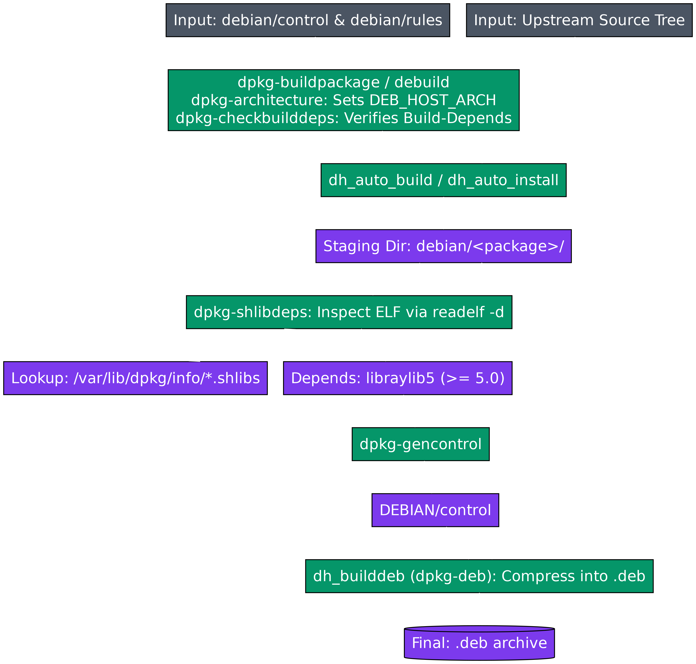
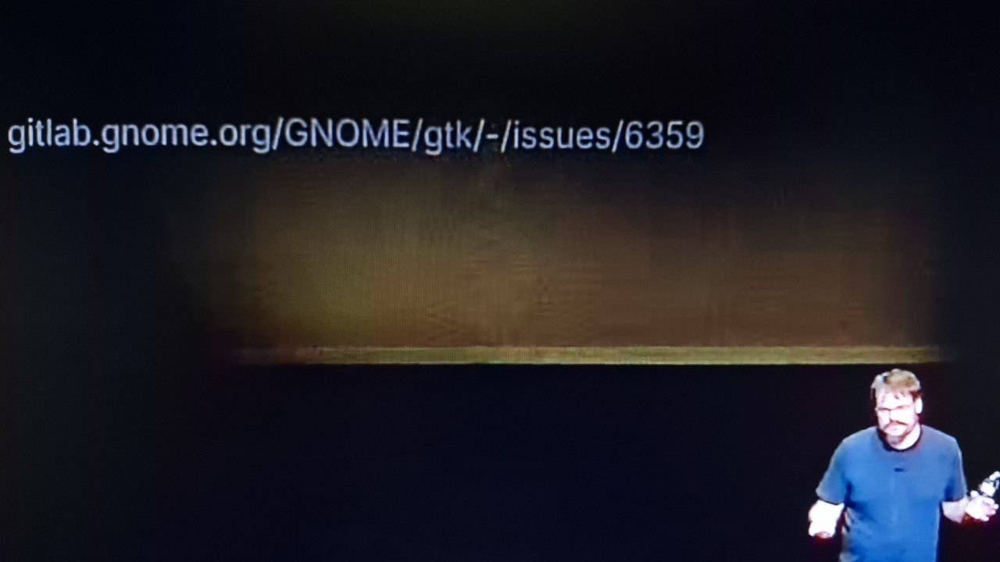
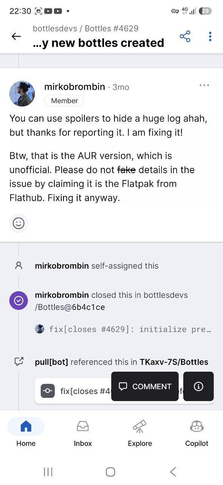
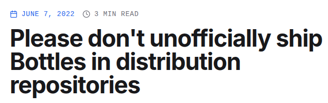

# Packathon

### Packaging e Distribuzione Software su Linux

<p class="text-muted" style="margin-top: 30px;">Linux Day Trieste 2026</p>

Note:
Lasciare ocio in esecuzione live su un secondo schermo o finestra divisa.
Gag di apertura:
"Gli organizzatori mi hanno invitato qui oggi per parlarvi di packaging e release engineering. Ma siamo onesti: io in realta' sono qui per mostrarvi la mia applicazione vibecodata in 15 minuti che vi cambiera' per sempre la vita."
Muovere il mouse, mostrare l'occhio che traccia il cursore, premere V per mostrare la versione (Ocio v0.1.0).
"Ora che l'avete vista, so che la volete tutti. Ma non ho un server o una pipeline di distribuzione. Quindi ho deciso di distribuirla alla vecchia maniera."
Estrarre il floppy disk fisico da 3.5" dalla borsa:
"Se a fine talk mi lasciate il vostro indirizzo postale e un francobollo, ve la spedisco per posta."
Il ritorno alla realta':
Cosa succede se carico questo binario grezzo compilato su un server web e dico a 50 sconosciuti di scaricarlo ed eseguirlo?
Fallisce immediatamente su macchine diverse: glibc disallineata, collegamenti dinamici DT_NEEDED mancanti (libGL.so, libX11.so), socket del display server assente o problemi di permessi.
La cavia: perche' questa app:
Sorgente volutamente banale: un solo main.c, ~280 righe di C99 pulito, zero logica di business: nulla compete con il packaging per l'attenzione.
Footprint di runtime massimamente realistico: richiede accelerazione hardware OpenGL via DRI, un display server attivo (X11 / Wayland) e IPC su memoria condivisa (MIT-SHM).
"Sorgente massimamente semplice, footprint di runtime massimamente realistico."

--

<div class="center-card">
  
  <p class="text-muted" style="font-size: 0.45em; margin-top: 12px; opacity: 0.7;">Foto: <a href="https://commons.wikimedia.org/wiki/File:Floppy_disk_2009_G1.jpg" target="_blank">Floppy Disk da 3.5"</a> di George Chernilevsky (Pubblico Dominio / CC0)</p>
</div>

--

## Slides
<!-- .slide: class="text-center" -->

<div class="center-card">
  
  <p><a href="https://michelepagot.github.io/packathon/" target="_blank">michelepagot.github.io/packathon</a></p>
</div>

Note:
Pausa per consentire al pubblico di inquadrare il QR code e seguire live su smartphone o portatili.

--

## Speaker

* **Michele Pagot**
* **SUSE**: Quality Engineering (QE)
* GitHub: [`@michelepagot`](https://github.com/michelepagot) · [`@mpagot`](https://github.com/mpagot)

Note:
Breve presentazione del relatore.

--

## Disclaimer

* Non sono un package maintainer di professione.
* Lavoro in QE...

Note:
"Non sono un package maintainer di professione. Lavoro all'estremita' della pipeline: test, validazione e analisi degli output di rilascio su sistemi completi. Questo talk nasce come indagine ingegneristica per capire a fondo la catena che genera gli artefatti a monte prima che arrivino ai banchi di test."

--

## Agenda

1. **Intro**: Censimento, Prospettive, primer "Dipendenze"
2. **Formati**: RPM, DEB, AppImage, Flatpak
3. **Rilascio e Distribuzione**
4. **Conclusioni**

Note:
Panoramica sintetica della progressione del talk.

---

## Censimento

1. Chi usa Linux quotidianamente? <!-- .element: class="fragment" -->
2. Chi installa software esclusivamente tramite repository ufficiali? <!-- .element: class="fragment" --> <br><small class="text-muted">(APT, Zypper, DNF, Pacman, AUR... Emerge, Slackpkg, urpmi)</small>
3. Chi usa formati universali: Flatpak, AppImage o Snap? <!-- .element: class="fragment" -->
4. <!-- .element: class="fragment" --> `curl | sh`
5. Chi compila regolarmente da sorgenti? <!-- .element: class="fragment" --> <br><small class="text-muted">(<code>git clone &amp;&amp; cmake &amp;&amp; make &amp;&amp; sudo make install</code>)</small>

Note:
Scandire le 5 domande guardando la sala:
1. 100% mani alzate.
2. Repo ufficiali: cittadini modello con fiducia cieca nei maintainer.
3. Flatpak/AppImage: chi cerca novita' upstream o si e' arreso alla dependency hell.
4. curl | sh: pragmatismo notturno vs sicurezza della supply chain azzerata.
5. Compilazione: puristi di /usr/local.
Takeaway:
"Guardatevi intorno: in questa sala non esiste un solo modo in cui il software viene ricevuto su Linux. Ognuno opera con un modello di fiducia diverso, aspettative di aggiornamento diverse e compromessi operativi diversi."

--

## Prospettive

* <!-- .element: class="fragment" --> Utilizzatore
* <!-- .element: class="fragment" --> Sviluppatore
* <!-- .element: class="fragment" --> Maintainer

Note:
1. **L'Utilizzatore** (Vuole l'app, ma con esigenze opposte):
   - **Versioni:** Stabilità assoluta ("rocciosa") VS Novità day-zero.
   - **UX:** Installazioni e aggiornamenti senza attriti (zero configurazioni).
   - **Risorse:** Avvio istantaneo VS Risparmio di RAM/Disco.
   - **Portabilità:** Stessa esperienza garantita anche cambiando PC o distro.

2. **Lo Sviluppatore** (Vuole la massima diffusione):
   - **Focus:** Conosce la sua app a fondo, ma ignora i dettagli di 20 distro o hardware diversi.
   - **Asimmetria:** Controllo al 100% sul proprio codice, 0% sul sistema operativo dell'utente.
   - **Obiettivo:** "L'ho testato da me, deve funzionare senza sorprese da chi lo scarica".

3. **Il Maintainer / Distro Owner** (Vuole l'integrità del sistema):
   - **Focus:** Conosce l'OS e l'ecosistema (30k pacchetti), meno la singola app.
   - **Priorità:** Niente corruzioni, no conflitti ABI, patch di sicurezza centralizzate (es. CVE su OpenSSL).
   - **Filosofie:** Rolling release (Arch, Tumbleweed) VS Stabilità decennale (Debian, RHEL).

--

## Dipendenze

_"Sul mio computer va"_

```text
/ocio: error while loading shared libraries:
libOpenGL.so.0:
cannot open shared object file:
No such file or directory
```
<!-- .element: class="fragment" -->

Note:
Chiedere al pubblico il codice di uscita: 127.

Comando di test in container minimale:
$ podman run --rm -v ./build/bin/ocio:/ocio:ro,Z registry.opensuse.org/opensuse/tumbleweed:latest /ocio

Mostra il frammento del coniglio:
"Benvenuti nella tana del bianconiglio delle dipendenze: avete compilato senza errori, ma a runtime fallisce immediatamente."

Aggancio scenico:
"Abbiamo compilato, messo il binario su una chiavetta o scaricato da GitHub, e lo lanciamo su una macchina pulita. Risultato immediato: errore a runtime.
Chi ha interrotto l'esecuzione? Il programma e' crashato? E' stato il kernel?
Guardiamo cosa succede realmente sotto il cofano all'avvio."

--

## Avvio

1. **Shell**: ricerca in `$PATH` &rarr; `/usr/bin/ocio` <small>(`command -v ocio`)</small>
2. **Kernel**: `execve()` &rarr; `PT_INTERP` &rarr; `ld.so`
3. **ld.so**: `DT_NEEDED` &rarr; `/lib64/libOpenGL.so.0` trovato
4. `main()`

Note:
OS carica binario in memoria e passa il controllo a un componente in userspace: il dynamic linker (ld.so).
DL deve trovare e caricare tutte le librerie condivise richieste prima di avviare il eseguibile.
Se manca anche una sola libreria, ld.so termina il processo rc:127.
Il kernel non ha fallito e il nostro codice non è crashato"

Sotto il cofano:
1. Shell: individua `/usr/bin/ocio` tramite `$PATH` (`command -v ocio`).
2. Kernel: `execve()` mappa l'ELF e legge `PT_INTERP` (la stringa `/lib64/ld-linux-x86-64.so.2` dalla sezione `.interp`).
   Allestisce lo stack iniziale, scrive l'Auxiliary Vector (auxv: AT_PHDR, AT_ENTRY, AT_BASE) e punta RIP direttamente a `ld.so`.
  Il kernel ha completato il suo compito con successo (codice 0)!
   (Contrasto: se il percorso dell'interprete non esistesse sul disco, execve fallirebbe subito nel kernel con ENOENT:
  "cannot execute: required file not found").
3. Dynamic Linker (`ld.so` in userspace): scansiona `DT_NEEDED` nell'ordine di ricerca
    (RPATH -> LD_LIBRARY_PATH -> RUNPATH -> /etc/ld.so.cache -> /lib64).
    Non trovando `libOpenGL.so.0` dopo i vari tentativi `openat()`, stampa l'errore e invoca la syscall `exit_group(127)`.
4. `main()`: non viene mai raggiunto.

Comando da mostrare:
`readelf -p .interp ./ocio` (mostra il percorso del dynamic linker incorporato nell'ELF)

Ponte verso la slide successiva:
"Andiamo a ispezionare direttamente il binario per capire cosa stava cercando il dynamic linker."
"Il kernel valida l'array di 16 byte e_ident (\x7fELF). Teniamo a mente questi 16 byte: vedremo nel Capitolo 5 come AppImage riutilizza lo spazio di padding inutilizzato alla fine dell'header."


**Cosa accade realmente (Il mito del main):**
- L'esecuzione *non* inizia in `main()`.
- Il Kernel carica il binario e cede il controllo a `ld.so` (userspace). Se manca una libreria, `ld.so` blocca tutto subito (exit 127).

**Sotto il cofano (Passo per Passo):**
1. **Shell**: Trova l'eseguibile via `$PATH`.
2. **Kernel (`execve`)**:
   - Mappa l'ELF, legge `PT_INTERP` (es. `/lib64/ld-linux-x86-64.so.2`).
   - Prepara stack e Auxiliary Vector.
   - **Cruciale:** Passa il controllo (RIP) a `ld.so` (successo per il Kernel).
   - *(Se manca l'interprete: `execve` fallisce subito con ENOENT).*
3. **Dynamic Linker (`ld.so`)**:
   - Legge `DT_NEEDED`.
   - Cerca le librerie (ordine: RPATH -> LD_LIBRARY_PATH -> Cache -> /lib64).
   - Non trova `libOpenGL.so.0` &rarr; stampa errore &rarr; `exit_group(127)`.
4. **`main()`**: Mai raggiunto.

**Comando (Live/Demo):**
- `$ readelf -p .interp ./ocio` (Mostra il dynamic linker hardcoded nell'ELF).

**Ponte (Verso la prossima slide):**
- "Ispezioniamo il binario: cosa cercava il linker?"
- **Foreshadowing (AppImage):** Il kernel valida l'header ELF (`\x7fELF`). Nel Capitolo 5 vedremo come AppImage sfrutta il padding libero in questo header.

--

## Seguendo libOpenGL.so.0

```text
$ readelf -d ocio | grep NEEDED
 (NEEDED)  Shared library: [libm.so.6]
 (NEEDED)  Shared library: [libOpenGL.so.0]
 (NEEDED)  Shared library: [libGLX.so.0]
 (NEEDED)  Shared library: [libc.so.6]
```

```text
$ ldd ./ocio
    linux-vdso.so.1 (0x00007ffe315f6000)
    libm.so.6 => /lib64/libm.so.6 (0x00007f9c8f2b0000)
    libOpenGL.so.0 => not found
    libGLX.so.0 => not found
    libc.so.6 => /lib64/libc.so.6 (0x00007f9c8f0b0000)
    /lib64/ld-linux-x86-64.so.2 (0x00007f9c8f3b0000)
```
<!-- .element: class="fragment" -->

Note:
Metodo per tracciare le dipendenze di un eseguibile:
- `readelf -d` → legge la sezione `.dynamic`: cosa il binario *chiede* (`DT_NEEDED`), elenco fisso scritto dal linker a compile-time.
- `ldd` → esegue `ld.so` con `LD_TRACE_LOADED_OBJECTS=1`: cosa l'host *trova*, risolvendo su percorsi di sistema + `/etc/ld.so.cache`.

La prova:
- Sviluppo: librerie installate (desktop completo) → tutto risolto.
- Test: `libOpenGL.so.0` / `libGLX.so.0` → "not found" (non installate).

Dettaglio (solo se chiesto):
- Raylib non compare in `DT_NEEDED`: statica in `.text` nella build predefinita.
- Il backend GLFW di Raylib richiede `libOpenGL.so.0` + `libGLX.so.0` (libglvnd, non la vecchia libGL).

Comandi da mostrare:
`readelf -d ./ocio | grep NEEDED`
`ldd ./ocio`

Ponte:
"Compilava senza warning e girava perfettamente. Come fa un compilatore a produrre un binario che muore prima di entrare in main()?"

--

## Build vs. Runtime

<div class="grid-2">
<div>

### Build-Time
Consumate **una volta**
<ul class="text-muted" style="font-size: 0.85em;">
<li>Header &amp; librerie statiche</li>
<li>Compilatore &amp; tool</li>
</ul>

</div>
<div>

### Runtime
Richieste **a ogni avvio**
<ul class="text-muted" style="font-size: 0.85em;">
<li>`.so` dinamiche &amp; `glibc`</li>
<li>Display &amp; nodi GPU</li>
</ul>

</div>
</div>

<p class="fragment text-info" style="margin-top: 35px;">
<em>In C, un binario dinamico è un contratto incompleto con l'OS host.</em>
</p>

Note:
"Perché ha compilato senza errori se poi non può essere eseguito?"

Il contratto (una riga per colonna della slide):
- **Build-time** = una volta sola: servono solo header `.h` (firme) e stub (offset di rilocazione). Non verifica che le `.so` esistano sull'host.
- **Runtime** = a ogni avvio: servono le `.so` concrete, un display server attivo (X11/Wayland) e i driver GPU.

Perché non `gcc -static` come Go/Rust? (solo se c'è tempo)
- Esperimento reale (Variante 7): `ld` rifiuta subito — `attempted static link of dynamic object '/usr/lib64/libOpenGL.so'`.
- `libglvnd` non fornisce archivi `.a`.
- Driver GPU DRI (`iris_dri.so`, `nvidia.so`) caricati a runtime via `dlopen()`: impossibile statici.
- glibc statica rompe i plugin NSS (`/etc/nsswitch.conf`).

Comando da mostrare:
`gmake -C build-07-attempt-static 2>&1 | grep "attempted static link"`

Ponte verso Formati:
"Il binario richiede queste librerie, ma l'host non le possiede. Ogni formato le colma in modo diverso: entriamo nel packaging."

---

## Formati

| Target | Meccanismo |
|---|---|
| **Standalone Tarball** | Archivio compresso (`.tar.gz`) con asset e `.desktop` |
| **RPM (`.rpm`)** | Payload CPIO per Fedora/openSUSE/RHEL/... |
| **Debian (`.deb`)** | Archivio `ar` per Debian/... |
| **AppImage** | File unico con SquashFS montato via FUSE |
| **Flatpak** | Sandbox Bubblewrap su runtime Freedesktop |

Note:
Lo spettro dei formati esplorati: dal semplice tarball non gestito ai pacchetti di sistema, bundle auto-montanti e sandbox desktop.
Regola di conteggio: non citare mai il numero totale dei formati a voce (le liste differiscono intenzionalmente tra le sezioni).
Transizione verso la Rotta 1: approfondiremo i 4 grandi formati desktop (RPM, DEB, AppImage, Flatpak), partendo dalla delega alla distribuzione.

---

## RPM: Standard Nativo

<div class="grid-2" style="align-items: center; gap: 40px; margin-top: 30px;">
<div style="flex: 0 0 auto;">
  
</div>
<div style="flex: 1; font-size: 1.05em; line-height: 1.8;">

* *Marc Ewing &amp; Erik Troan* (Red Hat, 1997)
* Archivio con metadati di dipendenza
* Standard enterprise e distro (LSB)

</div>
</div>

Note:
Introduciamo RPM:
- Origine: Nasce nel 1995 da Marc Ewing ed Erik Troan (Red Hat); la slide riporta il 1997, anno della prima release stabile (RPM 3.0) che ne fissa il formato.
- Nome: "RPM" sta per "Red Hat Package Manager"; oggi e' diventato un acronimo ricorsivo, "RPM Package Manager".
- Antenati (solo se c'e' tempo): RPM nasce dall'esperienza con pms (1993, Bogus Linux) e rpp, e convive brevemente con pm (1995, Rik Faith e Doug Hoffman). Non e' una rinomina PM -> PPM -> RPM: pm e' un progetto separato, e PPM e' un altro tool (Puppy Linux).
- Implementazione: scritto in Perl all'inizio; la riscrittura in C avviene gia' nel 1995 (RPM 1.4, novembre; RPM 2.0, marzo 1996, e' la prima versione interamente in C).
- Natura: Un archivio con metadati che trasporta file e dichiara dipendenze formali.
 - Diffusione: Lo standard di riferimento per openSUSE, SLE, Fedora e RHEL (specifica LSB).

--

## RPM: Chi lo usa
<!-- .slide: data-logos="image/redhat.png image/fedora.png image/centos-stream.png image/rocky-linux.png image/almalinux.png image/oracle-linux.png image/suse-linux-enterprise.png image/opensuse.png image/mageia.png image/openmandriva.png image/pclinuxos.png image/rosa-linux.png image/tizen.png image/sailfish-os.png image/qubes-os.png image/asahi-linux.png image/cbl-mariner.png image/asianux.png image/red-star-os.png" -->

  <p class="text-muted" style="margin-bottom: 10px;">Distribuzioni che usano RPM sotto il cofano</p>

* <!-- .element: class="fragment" data-fragments="logos" --><strong>Red Hat</strong>: RHEL, Fedora, CentOS Stream, Rocky, AlmaLinux, Oracle
* <!-- .element: class="fragment" data-fragments="logos" --><strong>SUSE</strong>: SLE, openSUSE (Tumbleweed/Leap)
* <!-- .element: class="fragment" data-fragments="logos" --><strong>Mandriva/Mageia</strong>: Mageia, OpenMandriva, PCLinuxOS, ROSA
* <!-- .element: class="fragment" data-fragments="logos" --><strong>Mobile/embedded</strong>: Tizen, Sailfish OS
* <!-- .element: class="fragment" data-fragments="logos" --><strong>Sicurezza/altre</strong>: Qubes OS, Asahi Linux, CBL-Mariner, Asianux, Red Star OS
* <!-- .element: class="fragment" data-fragments="logos" --><strong>Non-Linux</strong>: AIX, IBM i, NetWare, ArcaOS

Note:
 - Famiglia Red Hat: RHEL, Fedora, CentOS Stream, Rocky Linux, AlmaLinux, Oracle Linux.
 - Famiglia SUSE: SUSE Linux Enterprise (SLE) e openSUSE (Tumbleweed/Leap).
 - Famiglia Mandriva/Mageia: Mageia, OpenMandriva, PCLinuxOS, ROSA Linux.
 - Mobile/embedded: Tizen (Samsung), Sailfish OS (Jolla).
 - Sicurezza/altre: Qubes OS, Asahi Linux (Apple Silicon), CBL-Mariner (Microsoft), Asianux, Red Star OS.
 - Non-Linux: RPM e' stato portato anche su AIX, IBM i, NetWare e ArcaOS.
 - Frontend: lo stesso formato RPM e' interrogato da frontend diversi a seconda della distro: zypper (SUSE), dnf/yum (Red Hat/Fedora), urpmi (Mandriva/Mageia), apt-rpm (Ark/ALT).
  - Takeaway: "Stesso formato, tanti dialetti: il file .rpm e' identico, cambia solo chi lo installa."

--

## Dentro un RPM: Struttura

```text
$ file ocio-0.1.0-1.x86_64.rpm
ocio-0.1.0-1.x86_64.rpm: RPM v3.0 bin i386/x86_64
```
<!-- .element: class="fragment" -->

| Lead | Signature | Header | Payload |
|:---:|:---:|:---:|:---:|
| `magic` | `digests, GPG` | `name, deps, files` | `cpio (zstd)` |

<!-- .element: class="fragment" -->

```text
$ xxd -l 96 -d ocio-0.1.0-1.x86_64.rpm
0000: edab eedb 0300 0000 0001 6f63 696f 2d30  ..........ocio-0
0016: 2e31 2e30 2d31 0000 0000 0000 0000 0000  .1.0-1..........
0032: 0000 0000 0000 0000 0000 0000 0000 0000  ................
0048: 0000 0000 0000 0000 0000 0000 0000 0000  ................
0064: 0000 0000 0000 0000 0000 0000 0001 0005  ................
0080: 0000 0000 0000 0000 0000 0000 0000 0000  ................
```
<!-- .element: class="fragment" style="font-size: 0.48em; line-height: 1.2;" -->

Note:
file identifica il formato dai byte magici (ed ab ee db): "RPM v3.0" e' il formato lead legacy, ancora scritto da rpm moderno per compatibilita'.
xxd mostra i primi 96 byte del Lead fisso:
- Byte magici ed ab ee db (offset 0..3)
- Versione 3.0 (4..5) e tipo pacchetto binario (6..7)
- Nome pacchetto "ocio-0.1.0-1" in ASCII (10..22)
- Tipo di signature header-style (00 05 a offset 78)
Anatomia del file:
- Lead: blocco fisso legacy di 96 byte, oggi quasi solo un magic number.
- Signature: digest di header e payload, piu' la firma GPG quando presente (il nostro non ne ha).
- Header: tutti i metadati che interroghiamo con rpm -q (nome, versione, Requires, Provides, elenco file con digest).
- Payload: i file effettivi, in un archivio cpio compresso con zstd (rpm -qp --qf '%{PAYLOADFORMAT} %{PAYLOADCOMPRESSOR}' stampa "cpio zstd").

--

## Dentro un RPM: Estrazione

```text
$ rpm2cpio ocio-0.1.0-1.x86_64.rpm | file -
/dev/stdin: ASCII cpio archive (SVR4 with no CRC)
```

```text
$ rpm2cpio ocio-0.1.0-1.x86_64.rpm | cpio -idmv
./usr/bin/ocio
./usr/share/applications/ocio.desktop
...
```
<!-- .element: class="fragment" -->

Note:
Cos'e' cpio:
- Formato di archivio Unix degli anni '70 ("copy in / copy out"), stessa idea di tar: una sequenza lineare di record (header + dati file).
- Nessuna compressione e nessun indice interno; la compressione viene applicata sopra (qui zstd).
- Variante SVR4 "newc": header ASCII, magic "070701". Il kernel Linux usa lo stesso formato per l'initramfs.
Come estrarlo:
- rpm2cpio rimuove lead, signature e header, decomprime il payload e scrive il flusso cpio su stdout.
- cpio -i estrae, -d crea le directory, -m preserva i timestamp di modifica, -v elenca i file.
- I percorsi sono relativi (./usr/...): tutto finisce nella directory corrente, il sistema non viene toccato.
- Scorciatoia: bsdtar -tf / -xf legge direttamente i file RPM.
- L'eseguibile estratto ./usr/bin/ocio e' identico byte per byte al binario compilato.
Messaggio chiave: estrarre significa solo copiare file. Nessun controllo di dipendenze, nessun record nel database, nessuno script. L'installazione e' cio' che rpm aggiunge sopra: tenetelo a mente per le prossime slide.

--

## Dentro un RPM: Payload

```text
$ rpm -qlp ocio-0.1.0-1.x86_64.rpm
/usr/bin/ocio
/usr/share/applications/ocio.desktop
/usr/share/icons/hicolor/256x256/apps/ocio.png
/usr/share/icons/hicolor/scalable/apps/ocio.svg
/usr/share/metainfo/org.packathon.ocio.metainfo.xml
```

Note:
rpm puo' interrogare il file senza installarlo (-p = file di pacchetto).
Dettaglio del payload (directory omesse dall'elenco):
- /usr/bin/ocio: il binario, posizionato in una directory gia' presente nel $PATH di sistema.
- .desktop + icone: desktop entry e icone per consentire al desktop environment di mostrarlo nei menu.
- metainfo XML: metadati AppStream affinche' i software center grafici (GNOME Software, Discover) presentino descrizioni, categorie e screenshot.

--

## Dentro un RPM: Metadati

```text
$ rpm -qp --requires ocio-0.1.0-1.x86_64.rpm
libOpenGL.so.0()(64bit)
libGLX.so.0()(64bit)
libc.so.6(GLIBC_2.34)(64bit)
libm.so.6(GLIBC_2.43)(64bit)
...
```

```text
$ rpm -qp --provides ocio-0.1.0-1.x86_64.rpm
ocio = 0.1.0-1
application(ocio.desktop)
```
<!-- .element: class="fragment" -->

Note:
Ispezione dell'header:
- Guardate i Requires: libOpenGL.so.0, libGLX.so.0. Questo e' esattamente l'elenco DT_NEEDED del crash iniziale.
- Nessuno ha scritto queste righe a mano: il dependency generator di rpmbuild scansiona il binario ELF (DT_NEEDED + versioni simboli glibc) e compila l'header in automatico.
- Provides: cosa offre questo pacchetto al sistema (nome pacchetto, versione e capacita' desktop).
- Parcheggiamo GLIBC_2.43: notate questa baseline di simboli; ci torneremo analizzando i trade-off della delega.

--

## Cucinare un RPM

<div style="text-align: center;">

</div>

Note:
Come si costruisce un RPM nativo:
- Per costruire un RPM nativo servono l'archivio sorgente in SOURCES/ e la ricetta in SPECS/.
- Eseguendo `rpmbuild -ba ocio.spec` legge la ricetta in SPECS/ e il tarball in SOURCES/.
- Esegue prep, build, installazione simulata in una directory di staging (BUILDROOT) e genera sia il pacchetto binario (.rpm) che il pacchetto sorgente (.src.rpm).
- Il package manager non compila il software; rpmbuild e' il tool dedicato per la creazione dei pacchetti.
In the wild: Wezterm genera lo spec a runtime con un heredoc dentro ci/deploy.sh, con 3 subpacchetti (wezterm-common, wezterm-gui, wezterm-mux-server) e condizionali %if 0%{?suse_version} / %if 0%{?fedora} per i nomi dei pacchetti. OpenTofu non usa rpmbuild: nFPM assembla il .rpm in-process, senza toolchain esterna.

--

## .spec: Preambolo

* **Preambolo**
* **NVR** = `Name` + `Version` + `Release` &rarr; il nome file `.rpm`

Note:
La porzione superiore di uno spec file RPM, con righe come Name, Version, Release, License, Source0, si chiama Preambolo (o sezione Header). Precede gli scriptlet del corpo (%prep, %build, %install).
- Ogni coppia chiave-valore (Name:, License:, Source0:) è un **tag** (detto anche header tag o spec tag). "Direttiva" è un termine più ampio che copre sia questi tag sia le sezioni di build %, quindi su questa slide "tag" è la parola precisa per le righe del Preambolo.
- Name + Version + Release insieme si chiamano NVR; definiscono l'identità unica del nome file del pacchetto (NAME-VERSION-RELEASE.rpm).
- Il Preambolo contiene metadati statici che gli strumenti RPM leggono durante query e build: identità, licenza, URL upstream, archivi sorgenti.
- Insieme completo dei tag comuni: Name, Version, Release, Summary, License, URL, Source0, BuildRequires, Requires.

--

## .spec: Sezioni di Build

* **`%prep`** &rarr; **`%build`** &rarr; **`%install`** &rarr; **`%files`**
* Le direttive `%` sono il **ciclo di vita della build**

Note:
Le direttive % sono le Sezioni di Build (Body Sections / Fasi di Build), a differenza dei tag di metadato del Preambolo.
- Definiscono il ciclo di vita della build: gli script shell e le macro passo-passo che rpmbuild esegue per trasformare il sorgente grezzo in un RPM finito.
- %prep: prepara l'albero di build, solitamente scompattando i tarball con %autosetup.
- %build: invoca il sistema di build tramite macro di distro (%cmake e %cmake_build).
- %install: installa gli artefatti in una root temporanea pulita (BUILDROOT) che replica il filesystem di destinazione.
- %files: manifest esplicito dei file presenti in BUILDROOT da includere nel payload RPM. Qualsiasi file non tracciato provoca un errore di build.
- %changelog: storico delle imballature (data, maintainer, versione, modifiche).
- Distinzione: Preambolo = metadati chiave-valore statici; Sezioni di Build = il ciclo di vita eseguibile della build.

--

## .spec: Dipendenze

* **`BuildRequires`**: Contratto esplicito per tool e header
* **Chroot puliti**: Dipendenza mancante &rarr; build fallita subito
* **Grafo ermetico**: Rete disabilitata (OBS / Koji), riproducibile

Note:
Gestione delle dipendenze a build-time:
- Il packager dichiara BuildRequires in modo esplicito per tutti i compilatori, i tool e gli header di sviluppo (-devel, come gcc, cmake >= 3.16, pkgconfig, raylib-devel, Mesa-libGL-devel).
- Nei buildroot puliti (OBS, Koji o mock), la connessione di rete e' disabilitata. Se una dipendenza non e' indicata in BuildRequires, la compilazione si interrompe all'istante.
- Questo garantisce un grafo delle dipendenze strettamente verificabile e riproducibile.

--

## .spec: Dipendenze a Runtime

* **`find-requires`** &rarr; `Requires:`
* **`DT_NEEDED`** &rarr; visto
* **`dlopen()`** &rarr; invisibile

Note:
Gestione delle dipendenze a runtime:
- Nessuno scrive a mano Requires: libc.so.6 nel file spec.
- Dopo %install, rpmbuild esegue lo script interno find-requires su tutti i binari ELF in BUILDROOT.
- La dualita' a runtime:
  1. Le librerie collegate normalmente sono registrate in DT_NEEDED: find-requires le legge in automatico ed emette i requisiti del pacchetto insieme alle versioni dei simboli glibc.
  2. Le librerie caricate a runtime tramite dlopen() e puntatori a funzione: invisibili a find-requires perche' non compaiono nella sezione dinamica ELF.
- Il contratto generato: find-requires traduce i simboli e le voci DT_NEEDED nelle righe Requires: del RPM costruito.

--

## CPack

* Packaging integrato in CMake: nessun file `.spec` manuale

```cmake
set(CPACK_GENERATOR "TGZ;DEB;RPM")
set(CPACK_RPM_PACKAGE_AUTOREQPROV ON)
include(CPack)
```

* Comando: `cpack -G RPM`

Note:
Il flusso con CPack:
- Per uno sviluppatore che usa CMake, CPack permette di creare pacchetti RPM senza scrivere a mano un file .spec.
- Bastano poche righe in CMakeLists.txt e lanciare `cpack -G RPM` per ottenere il pacchetto.
- Genera lo spec internamente e invoca rpmbuild.
- La build CMake standard conserva DT_NEEDED -> find-requires rileva libOpenGL.so.0 -> si installa e funziona subito ("funziona e basta!").
In the wild: CPack e' il percorso "artigianale". Le pipeline di produzione arrivano allo stesso .rpm con nFPM (OpenTofu, in-process, senza rpmbuild) o con rpmbuild su uno spec generato (Wezterm). Stesso formato, due vie di accesso.

--

## La Trappola di --as-needed

* <!-- .element: class="fragment" --> `%cmake` &rarr; `-Wl,--as-needed`
* <!-- .element: class="fragment" --> dispatch GL via `dlopen()` &rarr; rimosso da `DT_NEEDED`
* <!-- .element: class="fragment" --> 1 pacchetto (904 KiB) non 36 (53 MiB) &rarr; crash a runtime

```rpm
# In ocio.spec: bridging the dlopen() blind spot
Requires: libOpenGL.so.0()(64bit)
Requires: libGLX.so.0()(64bit)
```
<!-- .element: class="fragment" -->

Note:
La trappola per chi scrive lo spec:
- Con CPack tutto "funzionava e basta".
- Ma quando l'autore scrive ocio.spec per le distribuzioni ufficiali usando macro come %cmake, la toolchain di distro inietta flag di hardening, in particolare -Wl,--as-needed.
- Poiche' Raylib risolve i punti di ingresso OpenGL dinamicamente tramite puntatori e dlopen(), GNU ld con --as-needed considera il link non necessario e rimuove libOpenGL.so.0 e libGLX.so.0 da DT_NEEDED.
- find-requires scansiona unicamente DT_NEEDED: non trova dipendenze grafiche ed emette solo libc e libm.
- L'RPM compila senza errori, ma Zypper installa solo 1 pacchetto (904 KiB, senza dipendenze grafiche) invece di 36 (53 MiB). Il programma si avvia, ma va in crash all'apertura della finestra!
- La soluzione: l'autore deve colmare manualmente il punto cieco di dlopen() dichiarando le capability virtuali in ocio.spec tramite Requires: (il blocco di codice sopra).
In the wild: la trappola e' specifica del C con librerie dinamiche. I binari Go (CGO off) e Rust (statici) non hanno uno stack GL in DT_NEEDED, quindi il punto cieco di find-requires / dpkg-shlibdeps non si presenta. E' per questo che OpenTofu e Wezterm non si scontrano con --as-needed.

--

## DEB: Dipendenze

* **`dpkg-shlibdeps`**: scan ELF in staging
* **`*.shlibs`**: SONAME → pacchetto + versione
* **`symbols`**: vincoli per simbolo (opzionale)
* **Output**: `DT_NEEDED` → `Depends: ${shlibs:Depends}`

Note:
- `debian/control`: `Depends: ${shlibs:Depends}` (variabile, non a mano)
- Build: `dh_shlibdeps` (debhelper) → `dpkg-shlibdeps`
- Scan ELF in staging → per ogni `DT_NEEDED`: lookup `*.shlibs` in `/var/lib/dpkg/info/` → (pacchetto, versione)
- Dualita' come RPM: `DT_NEEDED` visto / `dlopen()` invisibile
- `shlibs`: 1 riga per SONAME, es. `libOpenGL.so.0 libgl1 (>= 1.3.2)`
- `symbols`: vincoli per simbolo → tracciamento ABI esatto
- In the wild: Wezterm → `dpkg-shlibdeps -O -e debian/usr/bin/*` in container target
- Demo live (successo + modalita' di fallimento): `packaging/packator.sh debian builder packaging/deb/build-deb.sh --with-shared --pause`
- Differenza di modalita' di fallimento rispetto a RPM: qui la libreria deve essere un pacchetto noto al sistema di packaging (con un file shlibs leggibile), altrimenti la build fallisce rumorosamente. In RPM, find-requires emette il SONAME come capability senza bisogno di un database di pacchetti.

--

## DEB: Il Lookup *.shlibs

```text
$ apt install libgl1
```

```text
$ cat /var/lib/dpkg/info/libgl1:amd64.shlibs
libOpenGL.so.0 libgl1 (>= 1.3.2)
libGL.so.1 libgl1 (>= 1.3.2)
```

* **Posto da**: `apt install` / `dpkg -i`
* **Usato da**: `dpkg-shlibdeps` per mappare SONAME (pacchetto, versione)

Note:
La tabella di lookup *.shlibs:
- Ogni pacchetto che fornisce librerie condivise deve fornire un file .shlibs in /var/lib/dpkg/info/. Il file si chiama <pacchetto>:<arch>.shlibs e contiene una riga per ogni libreria che il pacchetto fornisce.
- La colonna di sinistra è la forma libtool (nome + versione ABI), non la stringa SONAME grezza. dpkg-shlibdeps converte libm.so.6 -> libm 6 prima del lookup.
- Il file viene posto sulla macchina di build quando il pacchetto viene installato (apt install o dpkg -i). Non fa parte dell'albero dei sorgenti; fa parte del sistema installato.
- Questo è il "database di pacchetti" di cui dpkg-shlibdeps ha bisogno per mappare un SONAME a una coppia (pacchetto, versione). Senza di esso, la mappatura è impossibile.
- Contrasto RPM (solo per il relatore): find-requires non ha bisogno di un database del genere. Legge DT_NEEDED ed emette il SONAME come capability (libraylib.so.550()(64bit)) direttamente. Il lato DEB ha bisogno del salto extra SONAME-a-pacchetto, e quel salto è il punto in cui una libreria compilata da sorgente si rompe.

--

## DEB: Raylib Condivisa

* **`RAYLIB_SHARED=ON`**: `ocio` collega `libraylib.so.550` (compilata da sorgente)

```text
$ readelf -d .../libraylib.so.550 | grep SONAME
  (SONAME) Library soname: [libraylib.so.550]
```
<!-- .element: class="fragment" -->

```text
$ grep -r "libraylib" /var/lib/dpkg/info/*.shlibs
(no result)
```
<!-- .element: class="fragment" -->

* **Nessuna voce `*.shlibs`** &rarr; `Depends:` non calcolabile &rarr; la build abortisce
* **Fix**: fornire un pacchetto `libraylib550` (nessuna distro lo fornisce)
* **Demo**: [PR #27](https://github.com/michelepagot/packathon/pull/27) (rossa di proposito)

Note:
Dove vive la libreria condivisa?
- RAYLIB_SHARED=ON fa collegare a ocio la libraylib.so.550, compilata da sorgente via FetchContent. Un DEB non può incorporare un .so arbitrario e dichiarare una dipendenza su di esso: dpkg-shlibdeps deve mappare il SONAME a (pacchetto, versione) usando i file *.shlibs dei pacchetti installati.
- La macchina di build deve avere la libreria installata come pacchetto noto (con un file .shlibs leggibile). Un .so compilato da sorgente nell'albero di build non basta: nessun pacchetto lo possiede, nessuna voce .shlibs esiste, il lookup fallisce e la build abortisce.
- Fatti verificati sulle distro: Debian non fornisce raylib in alcun modo (apt-cache showpkg libraylib -> Unable to locate package). openSUSE fornisce raylib 6.0, SONAME libraylib.so.600, non la 5.5 che ocio richiede (rpm -q --whatprovides 'libraylib.so.550()(64bit)' -> nessun pacchetto). Quindi nessuna distro fornisce il SONAME corrispondente; un pacchetto libraylib550 dovrebbe essere contribuito.
- Tre opzioni (analisi del relatore): (1) fornire libraylib550 come pacchetto fratello con una riga Depends: - la fix corretta, fuori scope per la conferenza; (2) SHLIBDEPS_PRIVATE_DIRS - una trappola, converte un fallimento di build rumoroso in un fallimento a runtime silenzioso; (3) saltare il generatore DEB (passare TGZ) - ciò che fa il progetto, onesto ma incompleto.
- Parallelo AppImage: lo stesso flag RAYLIB_SHARED=ON, risposta diversa. Un AppImage incorpora il .so nella scatola (sopra l'excludelist); la ricetta appimagetool fatta a mano è l'errore perché non scansiona mai DT_NEEDED, quindi una libreria mancante è silenziosa in build e rumorosa a runtime. linuxdeploy è lo strumento di scansione su quel lato. Il dpkg-shlibdeps del DEB è lo strumento di scansione su questo lato; ha solo bisogno che la libreria sia un pacchetto noto.
- Contrasto RPM: find-requires non ha bisogno di un database di pacchetti. Legge DT_NEEDED ed emette il SONAME come capability (libraylib.so.550()(64bit)) direttamente. L'RPM viene costruito senza problemi; il fallimento si sposta al momento dell'installazione quando nessun repository fornisce la capability. Il lato DEB ha bisogno del salto extra SONAME-a-pacchetto, e quel salto è il punto in cui una libreria compilata da sorgente si rompe.

--

## Dopo l'Installazione: Risolto

```text
$ ldd /usr/bin/ocio
  libm.so.6 => /lib64/libm.so.6
  libOpenGL.so.0 => /lib64/libOpenGL.so.0
  libGLX.so.0 => /lib64/libGLX.so.0
  libc.so.6 => /lib64/libc.so.6
  libGLdispatch.so.0 => /lib64/libGLdispatch.so.0
  libX11.so.6 => /lib64/libX11.so.6
  libxcb.so.1 => /lib64/libxcb.so.1
  ...
```

Note:
Confronto diretto con il crash iniziale:
- Ogni libreria prima mancante (libOpenGL.so.0, libGLX.so.0) e' ora risolta con un percorso assoluto in /lib64.
- Notate la risoluzione transitiva: il loader ha risolto anche le dipendenze secondarie tirate dentro da libglvnd (libGLdispatch, libX11, libxcb).
- Il costo della delega: per installare il nostro pacchetto da 486 KB (904 KiB su disco), il SAT solver (libsolv) ha selezionato 36 pacchetti dal repository per un totale di 52.6 MiB di download.
- Il contratto userspace e' ora completamente soddisfatto dalla distribuzione.

Matrice ldd cross-distro (escludendo libraylib, statica in tutti e 4 i flavor funzionanti):
- openSUSE (fetch-static, fetch-shared, local-static — tutti identici): 9 librerie
  ld-linux, libc, libm, libOpenGL, libGLX, libGLdispatch, libX11, libxcb, libXau
- Debian (fetch-static, fetch-shared, local-static — tutti identici): 4 librerie
  ld-linux, libc, libm
- Le 6 librerie in più su openSUSE (libOpenGL, libGLX, libGLdispatch, libX11, libxcb, libXau) sono il backend X11/GL di GLFW. La build Debian di raylib collega staticamente il codice X11 di GLFW, quindi restano solo la C runtime e la libreria matematica.
- All'interno di ogni distro, statico vs condiviso vs fetch vs local non cambia nulla nelle dipendenze non-raylib. È la distro, non il flavor di build, a determinare il footprint di runtime.

--

## Come 1 è Diventato 36: libsolv

* <!-- .element: class="fragment" --> Contratto: `libOpenGL.so.0()(64bit)` (auto-estratta o dichiarata)
* <!-- .element: class="fragment" --> Motore: `zypper` / `dnf` &rarr; `libsolv`
* <!-- .element: class="fragment" --> SAT: vincoli &rarr; CNF &rarr; chiusura in ms

Note:
Perche' l'installazione del nostro singolo RPM ha tirato dentro altri 35 pacchetti?
- Il contratto richiede libOpenGL.so.0()(64bit), che sia auto-estratta da find-requires (build CPack) o dichiarata dal maintainer nel .spec per superare --as-needed.
- Le capability astratte (SONAME) disaccoppiano il binario dai nomi fisici dei pacchetti: qualsiasi pacchetto che fornisce libOpenGL.so.0()(64bit) (come libglvnd) soddisfa il contratto.
- Il comando rpm a basso livello non puo' risolvere la rete: rpm -i fallirebbe con dipendenza mancante.
- I frontend (Zypper / DNF) passano il catalogo del repository a libsolv, che interroga l'indice whatprovides.
- libsolv traduce requisiti e conflitti in clausole booleane in forma normale congiuntiva (CNF) (es. A richiede B -> NOT A OR B).
- In pochi millisecondi, il solver SAT (CDCL) calcola una chiusura consistente: sul nostro container minimale privo di stack grafico, soddisfare libglvnd porta a cascata Mesa, X11 e librerie DRM, totalizzando esattamente 36 pacchetti.
- Nota di scena: fissare l'immagine Tumbleweed per digest prima del talk. Un pull fresco sposta la chiusura a 40 pacchetti (53.4 MiB / 229.8 MiB); i 36 (52.6 MiB) della slide corrispondono all'immagine fissata del 2026-06-22. Allineare la slide a cio' che zypper stampa in diretta.

--

## Dopo l'Installazione: Registrato e Protetto

```text
$ rpm -qf /usr/lib64/libOpenGL.so.0
libglvnd-1.7.0-2.4.x86_64
```

```text
$ rpm -V ocio && echo clean
clean
```
<!-- .element: class="fragment" -->

```text
$ rpm -e --test libglvnd
error: Failed dependencies:
  libOpenGL.so.0()(64bit) is needed by (installed) ocio-0.1.0-1.x86_64
```
<!-- .element: class="fragment" -->

Note:
Installare significa copiare file e mantenere un database autorevole:
- Proprieta' (rpm -qf): ogni singolo file sul filesystem ha un pacchetto proprietario certo e tracciabile.
- Verifica integrita' (rpm -V): verifica i file rispetto ai digest sha256 memorizzati. Se un file viene manomesso, rpm -V lo segnala all'istante.
- Protezione dipendenze (rpm -e --test): il sistema impedisce la rimozione accidentale di librerie necessarie ad altri pacchetti installati.

--

## Chi conosce il buildsystem?

<div class="center-card">
  
  <p style="font-size: 0.5em; margin: 4px 0;"><a href="https://build.opensuse.org/request/show/1376894#comment-2306874" target="_blank">build.opensuse.org/request/show/1376894#comment-2306874</a></p>
</div>
<!-- .element: class="fragment" -->

<div class="center-card">
  
  <p style="font-size: 0.5em; margin: 4px 0;"><a href="https://build.opensuse.org/requests/1380854/changes" target="_blank">build.opensuse.org/requests/1380854/changes</a></p>
</div>
<!-- .element: class="fragment" -->

---

## DEB: Standard Debian

<div class="grid-2" style="align-items: center; gap: 40px; margin-top: 30px;">
<div style="flex: 0 0 auto;">
  
</div>
<div style="flex: 1; font-size: 1.05em; line-height: 1.8;">

* *Ian Murdock* (Debian, 1993)
* Rigide policy e conformità FHS
* Standard Debian, Ubuntu e Mint

<p class="fragment text-info" style="margin-top: 35px;">
<strong>Superpotere:</strong> Mappatura esatta dei simboli via <code>dpkg-shlibdeps</code> e scriptlet di controllo.
</p>

</div>
</div>

Note:
Introduciamo DEB:
- Origine: Creato nel 1993 da Ian Murdock per la release iniziale di Debian.
- Natura: Formato vincolato da rigide policy di packaging della distribuzione e conformita' FHS.
- Diffusione: Lo standard di riferimento per Debian, Ubuntu, Linux Mint e derivate.
- CLI quotidiana:
  * Ispezione: dpkg-deb -c (file) e dpkg-deb -I (metadati di controllo)
  * Installazione con risolutore: apt install ./file.deb
  * Verifica integrita': debsums (verifica integrita' file rispetto ai checksum md5)
- Superpotere: Mappatura esatta dei simboli di libreria e scriptlet di controllo.
Ora vediamo cosa c'e' fisicamente dentro un file .deb sul disco.

--

## DEB: Chi lo usa
<!-- .slide: data-logos="image/debian.png image/ubuntu.png image/linuxmint.png image/kali.png image/deepin.png image/tails.png image/raspberry.png image/devuan.png image/zorin.png image/popos.png image/elementary.png image/parrot.png image/mxlinux.png image/whonix.png image/sparky.png image/pureos.png image/knoppix.png image/trisquel.png image/antix.png image/q4os.png image/peppermint.png image/bodhi.png image/siduction.png image/webconverger.png" -->

  <p class="text-muted" style="margin-bottom: 10px;">Distribuzioni che usano DEB sotto il cofano</p>

* <!-- .element: class="fragment" data-fragments="logos" --><strong>Debian</strong>: Debian, Ubuntu, Linux Mint
* <!-- .element: class="fragment" data-fragments="logos" --><strong>Desktop moderne</strong>: Deepin, Zorin OS, Pop!_OS, elementary OS, MX Linux
* <!-- .element: class="fragment" data-fragments="logos" --><strong>Security/privacy</strong>: Kali Linux, Tails, Whonix, Parrot OS
* <!-- .element: class="fragment" data-fragments="logos" --><strong>Embedded/edge</strong>: Raspberry Pi OS
* <!-- .element: class="fragment" data-fragments="logos" --><strong>Derivati/altre</strong>: Devuan, SparkyLinux, PureOS, KNOPPIX, Trisquel, antiX, Q4OS, Peppermint, Bodhi, siduction, Webconverger

Note:
  - Famiglia Debian: Debian, Ubuntu (e tutte le sue varianti: Kubuntu, Xubuntu, Lubuntu, Ubuntu MATE, ecc.), Linux Mint.
  - Desktop moderne: Deepin (GUI proprietaria), Zorin OS (focalizzato su utenti Windows), Pop!_OS (System76), elementary OS (estetica macOS), MX Linux (community, basato su Debian Stable).
  - Security/privacy: Kali Linux (penetration testing), Tails (portatile, tutto via Tor), Whonix (isolamento Tor), Parrot OS (security + daily driver).
  - Embedded/edge: Raspberry Pi OS (ex Raspbian) per la SBC piu' diffusa al mondo.
  - Derivati/altre: Devuan (senza systemd), SparkyLinux (leggero), PureOS (libre, Librem), KNOPPIX (live forensics), Trisquel (100% software libero), antiX (molto leggero), Q4OS (DE KDE/Trinity), Peppermint OS (leggero, cloud-first), Bodhi (Moksha DE), siduction (live, basato su Debian Unstable), Webconverger (browser kiosk).
  - Frontend: lo stesso formato DEB e' gestito da dpkg (basso livello) e apt (risolutore di dipendenze), indipendentemente dalla distro.
  - Takeaway: "Stesso formato, stessa policy: il file .deb e' identico, cambia solo la GUI sopra."

--

## Dentro un DEB: Archivio Unix `ar`

```text
$ file ocio_0.1.0_amd64.deb
ocio_0.1.0_amd64.deb: Debian binary package (format 2.0)
```

```text
$ ar -t ocio_0.1.0_amd64.deb
debian-binary
control.tar.xz
data.tar.xz
```
<!-- .element: class="fragment" -->

```text
$ dpkg-deb -I ocio_0.1.0_amd64.deb | grep -E 'Depends|Recommends'
 Depends: libc6 (>= 2.35), libglx0, libx11-6
 Recommends: libxcursor1, libxi6, libxinerama1, libxrandr2
```
<!-- .element: class="fragment" -->

Note:
Anatomia di un file .deb:
- Non usa alcun formato contenitore proprietario: e' un archivio standard Unix ar (lo stesso formato usato per le librerie statiche .a).
- Contiene esattamente tre membri:
  1. debian-binary: stringa di testo con la versione del formato ("2.0\n").
  2. control.tar: archivio compresso con i metadati del pacchetto (file control, md5sums, scriptlet di manutenzione).
  3. data.tar: archivio compresso contenente i file del payload effettivo da scompattare sul filesystem.
- dpkg-deb -I: ispeziona i metadati di controllo. La riga Depends e' divisa in due: libc6 (>= 2.35) e' calcolata automaticamente da dpkg-shlibdeps dal DT_NEEDED del binario (libc, libm), mentre libglx0 e libx11-6 sono dichiarate a mano perche' GLFW le carica con dlopen() dopo main(), quindi sono invisibili allo scanner. Recommends elenca le librerie opzionali di input/geometria X11 senza le quali GLFW degrada.

--

## Dentro un DEB: Payload

```text
$ dpkg-deb -c ocio_0.1.0_amd64.deb
drwxr-xr-x root/root         0 ./
drwxr-xr-x root/root         0 ./usr/
drwxr-xr-x root/root         0 ./usr/bin/
-rwxr-xr-x root/root    497664 ./usr/bin/ocio
-rw-r--r-- root/root       245 ./usr/share/applications/ocio.desktop
-rw-r--r-- root/root      1892 ./usr/share/icons/hicolor/256x256/apps/ocio.png
-rw-r--r-- root/root       612 ./usr/share/icons/hicolor/scalable/apps/ocio.svg
-rw-r--r-- root/root       847 ./usr/share/metainfo/org.packathon.ocio.metainfo.xml
```

Note:
dpkg-deb -c elenca il contenuto di data.tar senza estrarlo (timestamp omessi per leggibilita'):
- /usr/bin/ocio: il binario, posizionato in una directory gia' presente nel $PATH di sistema.
- .desktop + icone: desktop entry e icone per consentire al desktop environment di mostrarlo nei menu.
- metainfo XML: metadati AppStream affinche' i software center grafici (GNOME Software, Discover) presentino descrizioni, categorie e screenshot.
- Il payload e' identico a quello dell'RPM: stessi file, stesso layout FHS. La differenza e' puramente nel formato contenitore (ar + tar vs. cpio) e nell'encoding dei metadati (file control vs. header RPM).

--

## Dentro un DEB: Metadati

```text
$ dpkg-deb -I ocio_0.1.0_amd64.deb
 Package: ocio
 Version: 0.1.0
 Architecture: amd64
 Maintainer: Packathon Maintainers <maintainers@packathon.org>
 Installed-Size: 1264
 Depends: libc6 (>= 2.35), libglx0, libx11-6
 Recommends: libxcursor1, libxi6, libxinerama1, libxrandr2
 Section: graphics
 Priority: optional
 Description: Raylib interactive eye-tracking educational demo
```
<!-- .element: class="fragment" -->

```text
$ dpkg-deb -e ocio_0.1.0_amd64.deb ./deb-control/
$ cat ./deb-control/control | grep -E 'Depends|Recommends'
 Depends: libc6 (>= 2.35), libglx0, libx11-6
 Recommends: libxcursor1, libxi6, libxinerama1, libxrandr2
```
<!-- .element: class="fragment" -->

Note:
Ispezione del file control:
- Guardate i Depends: libc6 (>= 2.35), libglx0, libx11-6. Questo e' l'equivalente a livello di pacchetto delle capability string libOpenGL.so.0()(64bit) dell'RPM.
- La differenza di granularita': RPM dichiara capability a livello SONAME (libOpenGL.so.0()(64bit)); DEB dichiara nomi di pacchetto (libglx0). Il risolutore mappa i nomi di pacchetto alle librerie effettive al momento della risoluzione.
- La riga Depends e' divisa in due: libc6 (>= 2.35) e' calcolata automaticamente da dpkg-shlibdeps dal DT_NEEDED del binario (libc, libm), mentre libglx0 e libx11-6 sono dichiarate a mano perche' GLFW le carica con dlopen() dopo main(), quindi sono invisibili allo scanner.
- dpkg-deb -e estrae il membro control.tar in una directory, esponendo il file control, md5sums e eventuali scriptlet di manutenzione (postinst, prerm, postrm, prerm).

--

## Dopo l'Installazione: Registrato e Protetto

```text
$ dpkg -S /usr/lib/x86_64-linux-gnu/libGLX.so.0
libglx0:amd64: /usr/lib/x86_64-linux-gnu/libGLX.so.0
```

```text
$ debsums ocio
/usr/bin/ocio: MD5 sum is OK
/usr/share/applications/ocio.desktop: MD5 sum is OK
```
<!-- .element: class="fragment" -->

```text
$ apt-get remove --dry-run libglx0
The following packages will be REMOVED:
  libglx0 ocio
```
<!-- .element: class="fragment" -->

Note:
Installare significa copiare file e mantenere un database autorevole:
- Proprieta' (dpkg -S): ogni file sul filesystem ha un pacchetto proprietario certo, l'equivalente Debian di rpm -qf. libGLX.so.0 e' posseduto da libglx0 (il dispatcher libglvnd); libOpenGL.so.0 e' posseduto dal pacchetto separato libopengl0.
- Verifica integrita' (debsums): verifica i file rispetto ai digest MD5 memorizzati nel file md5sums del control. Se un file viene manomesso, debsums segnala la discrepanza.
- Protezione dipendenze (apt-get remove --dry-run): il risolutore impedisce la rimozione accidentale di librerie necessarie ad altri pacchetti installati, allo stesso modo di rpm -e --test.
- Il database dpkg vive in /var/lib/dpkg/status; apt aggiunge un indice di repository e un risolutore piu' sofisticato (basato sugli stessi principi SAT di libsolv) sopra.

--

## Cucinare un DEB

<div style="text-align: center;">

</div>

Note:
Come si costruisce un DEB nativo:
- In Debian la ricetta non e' un singolo file come in RPM, ma una directory dedicata debian/ situata nella radice dei sorgenti.
- Il comando principale di build e' dpkg-buildpackage (o il wrapper di sviluppo debuild).
- Con `dpkg-buildpackage -us -uc -b` si compila il pacchetto binario saltando la firma GPG di sorgenti e changes.
- Il processo di compilazione e staging e' orchestrato da debian/rules, che delega al sequencer Debhelper (dh).
- Gli artefatti prodotti sono il pacchetto binario (.deb), il log di compilazione e il file .changes contenente i metadati per il caricamento nell'archivio.
- Nel repository la ricetta canonica vive in packaging/deb/debian/ (control, rules, changelog, source/format); build-deb.sh --mode debhelper la collega alla radice dei sorgenti e lancia dpkg-buildpackage -us -uc -b -d.
- La stessa build-deb.sh offre un secondo dialetto, --mode frugal: niente debhelper, si staggia il payload in uno skeleton FHS, si calcolano md5sums e Installed-Size a mano e si assembla l'archivio con dpkg-deb. Stesso formato ar, stessa dipendenza da dpkg-shlibdeps: due dialetti, un solo formato.
In the wild: a scala di produzione i due dialetti si estendono. OpenTofu usa nFPM (in-process, senza dpkg-deb né debhelper). Wezterm usa dpkg-deb + dpkg-shlibdeps nativi dentro il container Debian. Stesso formato ar, tre vie di accesso.

--

## Dentro debian/

* **`control`**: metadati e dipendenze
* **`rules`**: ciclo di build (`dh $@`)
* **`changelog`**: versione e release
* **`copyright`**: licenze DEP-5
* **`dh`**: sequencer di build

Note:
La struttura della ricetta Debian:
- debian/control: Dichiara i metadati del pacchetto, le dipendenze di compilazione (Build-Depends) e le dipendenze a runtime tramite variabili come ${shlibs:Depends}.
- debian/rules: Un Makefile eseguibile. Il packaging moderno usa `dh $@` per automatizzare le fasi (dh_auto_configure, dh_auto_build, dh_auto_install).
- debian/changelog: La fonte canonica per versione e release. In Debian non si dichiara Version in control; dpkg-parsechangelog la ricava dalla prima voce del changelog.
- debian/copyright: Manifest standard DEP-5 che documenta le licenze file per file per la verifica delle linee guida DFSG.
- Risoluzione a runtime: dh_shlibdeps scansiona i binari ELF, consulta il file shlibs/symbols di ogni libreria e compila in automatico ${shlibs:Depends}.

--

## Delega

* <!-- .element: class="fragment" --> Contratto Binario: Il pacchetto trasporta solo il payload &rarr; dipendenze delegate all'OS host
* <!-- .element: class="fragment" --> Chiusura Transitiva: Il solver (`libsolv` / APT) scansiona il grafo del repository
* <!-- .element: class="fragment" --> Esecuzione Diretta: `execve()` sul binario in `/usr`
* <!-- .element: class="fragment" --> Registro di Sistema: Il database host traccia proprietà dei file, checksum e dipendenze

Note:
Il paradigma architetturale della delega:
- Filosofia: Lo sviluppatore distribuisce unicamente il codice macchina e gli asset; la distribuzione fornisce tutte le librerie condivise e lo stack grafico.
- Risoluzione: zypper/dnf e apt non tirano a indovinare; i loro solver SAT calcolano la chiusura transitiva su decine di migliaia di pacchetti a catalogo.
- Esecuzione: A differenza di AppImage (mount FUSE) o Flatpak (sandbox bwrap), il pacchetto di distro viene eseguito direttamente con execve() del kernel senza runtime intermedi.
- Contabilita': Il package manager e' un registro autorevole che garantisce la proprieta' dei file, l'integrita' (rpm -V / debsums) ed evita dipendenze orfane o rotte.

--

## Dialetti

| Dimensione | RPM | DEB |
|---|---|---|
| **Contenitore** | CPIO | `ar` |
| **Tool** | `rpm` | `dpkg` |
| **Manager** | `zypper` | `apt` |
| **Gen deps** | `find-requires` | `dpkg-shlibdeps` |
| **Format deps** | capability SONAME | nome pacchetto via `*.shlibs` |
| **Ispezione** | `rpm -qlp` | `dpkg-deb -c` |
| **Audit** | `rpm -V` | `debsums` |
<!-- .element: style="font-size: 0.76em;" -->

Note:
Due dialetti, stesso principio ingegneristico:
- Contenitori: RPM usa un payload CPIO compresso (zstd o gzip); DEB usa un classico archivio Unix ar contenente control.tar (metadati) e data.tar (payload).
- Generazione dipendenze: find-requires scansiona le voci ELF DT_NEEDED ed emette ciascun SONAME direttamente come capability (es. `libraylib.so.550()(64bit)`) senza consultare un database di pacchetti; dpkg-shlibdeps deve mappare ciascun SONAME a (pacchetto, versione) tramite i file `*.shlibs` dei pacchetti installati, quindi ha bisogno di un database di pacchetti. Una libreria compilata da sorgente senza voce shlibs fa fallire la build DEB, mentre l'RPM viene comunque costruito ma richiede `libraylib.so.550()(64bit)`, che nessun repository fornisce: il fallimento si sposta dal build time all'install time.
- Ispezione: rpm -qlp FILE.rpm vs dpkg-deb -c FILE.deb per i file; rpm -qp --requires vs dpkg-deb -I per i metadati.
- Integrita': rpm -V PACKAGE controlla i digest salvati nel database RPM; debsums PACKAGE verifica i file rispetto ai digest md5sums.
- Risoluzione: Entrambi delegano a un risolutore ad alto livello (zypper/dnf con libsolv, apt con il suo motore di scoring).

--

## Delega: Trade-Off

<div class="grid-2" style="margin-top: 30px;">
<div class="box-success fragment">

#### Vantaggi

* Payload minimo: **486 KB** (52.6 MiB di download delegati)
* Librerie condivise: patchate a livello OS per tutte le app
* Proprietà e verifica: `rpm -qf`, `rpm -V` / `debsums`

</div>
<div class="box-danger fragment">

#### Limiti

* Accoppiamento ABI: vincolo a glibc host (es. `GLIBC_2.43`)
* Policy di distro: rispetto FHS, audit scriptlet di root
* Esplosione della matrice: una build per distribuzione e release

</div>
</div>

Note:
Valutazione dei trade-off della delega:
- Vantaggi: Elevata efficienza e manutenzione condivisa. Un pacchetto da 486 KB delega 52.6 MiB di download e ~226 MiB di dipendenze su disco a componenti mantenuti dalla distro. Le librerie condivise (es. libglvnd, Mesa) ricevono patch di sicurezza una sola volta per l'intero sistema.
- Limiti: Il binario e' strettamente accoppiato all'ABI dell'ambiente host, in particolare alle versioni dei simboli glibc. Il packaging nativo richiede il rispetto di rigide policy (FHS, divieto di bundling, controllo degli scriptlet di root) e una compilazione distinta per ogni distribuzione e architettura target.

---

## AppImage: Singolo File Portabile

<div class="grid-2" style="align-items: center; gap: 40px; margin-top: 30px;">
<div style="flex: 0 0 auto;">
  
</div>
<div style="flex: 1; font-size: 1.05em; line-height: 1.8;">

* *Simon Peter* (2004 *klik*, 2011)
* Un'app = un singolo file eseguibile
* Portabilità tra distro, zero installazione (niente root)

</div>
</div>

Note:
Introduciamo AppImage:
- Origine: Creato nel 2004 da Simon Peter (probono) come klik, rinominato nel 2011 come AppImage.
- Natura: Un'applicazione impacchettata come singolo file eseguibile con un'immagine SquashFS incorporata. Contiene le dipendenze che l'host non si presume abbia, non tutte (vedi "La Scatola Ha un Bordo").
- Diffusione: Formato upstream de facto per applicazioni desktop Linux portabili e autonome (non richiede root).
- CLI quotidiana:
  * Esecuzione: chmod +x ./file.AppImage && ./file.AppImage
  * Estrazione / Fallback: ./file.AppImage --appimage-extract (funziona senza FUSE)
- Il limite GLIBC: Include le librerie dell'applicazione, ma si appoggia a glibc e kernel dell'host. Regola d'oro: compila sulla distro piu' vecchia che intendi supportare.
Ora andiamo a vedere cosa c'e' fisicamente dentro il file AppImage sul disco.

--

## Dentro AppImage: Il Trucco di `EI_PAD`

```text
$ file ocio-x86_64.AppImage

ocio-x86_64.AppImage: ELF 64-bit LSB pie executable,
static-pie linked
```
<!-- .element: class="fragment" -->

| `00..03` | `04..07` | `08..0A` | `0B..0F` |
|:---:|:---:|:---:|:---:|
| `\x7fELF` | `x86_64/SystemV` | **`AI\x02`** | `padding (0x00)` |
<!-- .element: class="fragment" -->

```text
$ xxd -l 96 -d ocio-x86_64.AppImage
0000: 7f45 4c46 0201 0100 4149 0200 0000 0000  .ELF....AI......
0016: 0300 3e00 0100 0000 87ae 0200 0000 0000  ..>.............
0032: 4000 0000 0000 0000 7862 0e00 0000 0000  @.......xb......
0048: 0000 0000 4000 3800 0a00 4000 1e00 1d00  ....@.8...@.....
0064: 0100 0000 0400 0000 0000 0000 0000 0000  ................
0080: 0000 0000 0000 0000 0000 0000 0000 0000  ................
```
<!-- .element: class="fragment" style="font-size: 0.48em; line-height: 1.2;" -->

Note:
Dissezione dell'header binario di AppImage:
- Nel capitolo sui Fondamenti abbiamo visto che ogni binario ELF comincia con l'array di 16 byte e_ident.
- La specifica ELF definisce i byte da 8 a 15 come EI_PAD: padding riservato per future espansioni dell'ABI, convenzionalmente azzerato.
- AppImage Type 2 sovrascrive i byte 8, 9 e 10 con i caratteri ASCII 'A', 'I' e il byte 0x02.
- Perche' e' una soluzione geniale:
  1. Zero penalita' di esecuzione: il loader del kernel verifica solo i primi 4 byte (\x7fELF) e, come ld.so, ignora EI_PAD, lasciando il file un eseguibile perfettamente valido.
  2. Riconoscimento istantaneo: file manager, indicizzatori desktop, gestori app e file(1) non devono montare o scansionare i megabyte del payload SquashFS: leggere 11 byte identifica subito il formato, in tempo O(1).
  3. Versionamento del formato: le generazioni sono distinte chiaramente, AI\x01 per il vecchio Type 1 (ISO 9660) e AI\x02 per il moderno Type 2 (SquashFS + FUSE).
- Il caveat dell'emulazione: I kernel nativi ignorano EI_PAD, ma i layer di emulazione container (QEMU-user binfmt_misc) possono inciampare su byte di padding non standard restituendo ENOEXEC ("Exec format error"). Ecco perche' i runner ARM64 nativi sono necessari per build multi-arch affidabili.
- Lettura della tabella: la colonna "x86_64 / System V" (byte 04..07) e' una semplificazione. Il byte 7 (e_ident[7]) e' il campo OS/ABI: 01 = System V, l'ABI standard di Linux. L'architettura CPU reale (e_machine = 0x3e, x86-64) si trova piu' avanti nell'header ELF all'offset 18, visibile nella riga 0016: come 3e00. Lo 03 al byte 16 (e_abi) e' un campo di versione ABI piu' fine, quasi mai usato su Linux.

--

## Dentro un AppImage: Stub &amp; SquashFS

* **Stub runtime ELF**: launcher static-pie in testa al file (~922 KiB)
* **Payload SquashFS**: filesystem compresso accodato dietro (~451 KiB)

```text
$ unsquashfs -s -offset $(./ocio-x86_64.AppImage --appimage-offset) ocio-x86_64.AppImage

Found a valid SQUASHFS
4:0 superblock on ocio-x86_64.AppImage
Filesystem size 461732 bytes,
compression zstd
```
<!-- .element: class="fragment" -->

Note:
Meccanica di basso livello del binario AppImage:
- Un AppImage non e' un archivio con un installer. E' un binario composito: uno stub eseguibile ELF con un filesystem SquashFS compresso incollato dietro.
- Lo stub e' un eseguibile static-pie compilato con musl libc, libfuse3 e squashfuse.
- Il payload e' un filesystem SquashFS 4.0 puro compresso con zstd.
- Verifica forense: unsquashfs legge il superblock direttamente dal file senza necessitare di mount o privilegi di root. L'opzione --appimage-offset indica dove si trova la giunzione.
- Ingombro totale del file: 1.34 MiB (1.406.364 byte) — entra nel floppy da 1.44 MB con spazio da spare.

--

## Dentro AppImage: Ciclo di Vita del Mount

```text
$ ocio-x86_64.AppImage --appimage-mount
/tmp/.mount_ocio-xApLEba
```
<!-- .element: class="fragment" -->

```text
$ df -h | grep /tmp/.mount
ocio-x86_64.AppImage  451K  451K     0 100% /tmp/.mount_ocio-xApLEba

$ ls -1 /tmp/.mount_ocio-xApLEba
AppRun
ocio.desktop
ocio.png
usr
```
<!-- .element: class="fragment" -->

Note:
Il ciclo di vita del mount a runtime:
- Avvio e intercettazione: All'esecuzione, lo stub runtime ELF intercetta il controllo prima dell'avvio dell'applicazione. Crea una directory temporanea /tmp/.mount_XXXXXX e usa FUSE (squashfuse + libfuse3) per montare il payload SquashFS incorporato.
- Esecuzione: Il controllo passa allo script AppRun posto alla radice del mount, che configura le variabili d'ambiente (come PATH e LD_LIBRARY_PATH) e invoca usr/bin/ocio.
- Chiusura: Quando l'applicazione termina, lo stub runtime smonta il filesystem e rimuove il mount point.
- La tecnica di ispezione:
  Invece di tentare di catturare la directory effimera con loop di comandi watch, l'opzione --appimage-mount monta il filesystem, stampa il percorso e resta in attesa di Ctrl+C.
  In un'altra shell, df e ls mostrano la struttura FHS montata (usr/bin, usr/share, AppRun).
- Il requisito FUSE e il fallback:
  AppImage dipende dal supporto FUSE dell'host (/dev/fuse e fusermount3).
  In ambienti privi di FUSE (container, Docker o installazioni minimali), l'avvio fallisce.
  Il fallback ufficiale: --appimage-extract-and-run (oppure APPIMAGE_EXTRACT_AND_RUN=1) estrae in /tmp ed esegue senza FUSE.

--

## Cucinare un AppImage

```text
AppDir/
├── AppRun -> usr/bin/ocio
├── ocio.desktop
├── ocio.png
└── usr/
    ├── bin/ocio
    ├── lib/          ← bundled libraries
    └── share/...
```

| Ricetta | Chi riempie `usr/lib` |
|---|---|
| `appimagetool AppDir/ ocio.AppImage` | **Tu**, a mano. Nessuno controlla. |
| `linuxdeploy --appdir AppDir ...` + `appimagetool` | **Il tool**: legge `DT_NEEDED`, copia, imposta `RUNPATH` |
<!-- .element: class="fragment" -->

<p class="fragment" style="position: absolute; bottom: 0.3em; right: 1.5em; font-size: 0.85em; margin: 0;"><a href="https://github.com/wezterm/wezterm/blob/master/ci/appimage.sh" target="_blank">Wezterm</a></p>

Note:
Un AppImage e' un albero di directory compresso, l'AppDir:
- AppRun e' il punto di ingresso (qui un symlink al binario).
- Un file .desktop e la sua icona sono obbligatori al primo livello: senza, appimagetool si rifiuta di impacchettare.
- usr/ e' un piccolo filesystem root: binario, librerie incluse, file desktop, icone, metainfo.
Due ricette, entrambe in packaging/appimage/build-appimage.sh --method {linuxdeploy,appimagetool}:
- appimagetool a mano: assembliamo noi l'AppDir (install CMake, .desktop, icona, symlink AppRun). appimagetool comprime l'albero e ci mette davanti il runtime, niente di piu'. Non guarda mai le dipendenze: se il binario richiede una libreria che sull'host non c'e', nessuno ti avvisa.
- linuxdeploy (default dello script): percorre l'albero DT_NEEDED, copia in usr/lib ogni libreria che non e' nella excludelist di AppImage, imposta RUNPATH=$ORIGIN/../lib con patchelf, fa lo strip e crea AppRun. Poi appimagetool impacchetta il risultato.
- linuxdeploy e appimagetool sono a loro volta AppImage. Le immagini builder li contengono gia' estratti, quindi girano senza FUSE; lo script non scarica nulla e, se manca un tool, fallisce con le istruzioni per installarlo.
In the wild: Wezterm e' un utente di linuxdeploy in produzione. ci/appimage.sh scarica linuxdeploy dal release continuous, lo punta su AppDir, e imposta UPDATE_INFORMATION con lo schema gh-releases-zsync affinche' l'AppImage possa auto-aggiornarsi da GitHub Releases. E' la stessa ricetta della slide, ma con il self-update incorporato.
Messaggio chiave: "autocontenuto" non e' una proprieta' del formato. E' un lavoro di packaging, e la domanda successiva e': cosa va dentro la scatola?

--

## Cucinare un AppImage: Passo per Passo

```bash
cmake -S . -B build -DCMAKE_BUILD_TYPE=Release
cmake --build build
```

```bash
DESTDIR=AppDir cmake \
       --install build \
       --component ocio \
       --prefix /usr
```
<!-- .element: class="fragment" -->

```bash
linuxdeploy --appdir AppDir \
            --executable AppDir/usr/bin/ocio \
            --desktop-file ocio.desktop \
            --icon-file ocio.png
```
<!-- .element: class="fragment" -->

```bash
appimagetool --runtime-file /usr/lib/runtime-x86_64 \
             AppDir ocio-x86_64.AppImage
```
<!-- .element: class="fragment" -->

Note:
I quattro passi di build-appimage.sh (--method linuxdeploy):
1. **Compila**: build CMake Release standard, nulla di specifico per AppImage.
2. **Prepara**: installa solo il componente ocio (l'install di default include anche i file di sviluppo di raylib) in AppDir.
   - DESTDIR = dove l'albero viene scritto (staging reale, come BUILDROOT di rpmbuild).
   - --prefix = il layout che i file fingono di avere dentro.
   - --prefix /usr e' obbligatorio: AppImage richiede il layout FHS (usr/bin, usr/lib, usr/share) dentro AppDir. Con --prefix / otterremmo AppDir/bin/ocio, che linuxdeploy non riconoscerebbe.
3. **Includi**: linuxdeploy legge DT_NEEDED ricorsivamente, copia in usr/lib le librerie non in excludelist, imposta RUNPATH=$ORIGIN/../lib, crea AppRun e i link .desktop/icona. Per la build di default non copia nulla: tutto e' in excludelist (slide successiva).
4. **Impacchetta**: appimagetool crea l'immagine SquashFS e ci mette davanti il runtime type2 (lo stub ELF con magic AI\x02 della slide su EI_PAD). Runtime passato esplicito, altrimenti appimagetool lo scarica a ogni build.

La ricetta a mano (--method appimagetool) salta il passo 3: AppRun, .desktop e icona li mettiamo noi, e nessuno controlla le librerie.
Gli strumenti (linuxdeploy, appimagetool, runtime) sono gia' nelle immagini builder; linuxdeploy e appimagetool sono gia' estratti, girano senza FUSE.

--

## La Scatola Ha un Bordo

| Categoria | Dentro la scatola | Fuori: l'host |
|---|---|---|
| **Binario** | `ocio` + asset | glibc: `libc`, `libm`, `ld.so` |
| **GL** | Raylib (statica) | `libOpenGL`, `libGLX`, `libGLdispatch` |
| **Display / Audio** | — | X11 / xcb, `libdrm`, ALSA |

**Excludelist** di AppImage: librerie che si assume siano presenti su ogni desktop.
<!-- .element: class="fragment" -->

```text
$ ./ocio.AppImage            # vanilla Tumbleweed container
/ocio.AppImage: error while loading shared libraries: libOpenGL.so.0
```
<!-- .element: class="fragment" -->

Note:
Cosa e' la excludelist:
- pkg2appimage/excludelist, applicata da linuxdeploy: librerie "assunte presenti sull'host e quindi da NON includere".
- Contenuto: glibc, tutto lo stack GL (libOpenGL, libGLX, libGLdispatch, libGL, libEGL, libdrm), X11/xcb, ALSA.

Perche' GL resta fuori (stesso argomento di Build vs. Runtime):
- I driver GPU sono dispatcher dinamici che devono corrispondere alla scheda dell'host.
- libglvnd carica libGLX_mesa o libGLX_nvidia dall'host.
- Una Mesa inclusa funziona in un container e si rompe con il driver proprietario NVIDIA o con una GPU piu' recente della Mesa inclusa.

Il nostro ocio:
- raylib e' statica; DT_NEEDED contiene solo libm, libOpenGL.so.0, libGLX.so.0, libc.
- Tutte e quattro sono nella excludelist, quindi linuxdeploy non trova niente da includere.
- L'AppImage e' corretto secondo le regole del formato stesso.

L'errore nel container:
- E' il bordo della scatola, non un difetto della scatola.
- Installare libglvnd nel container ricrea il sistema base desktop che AppImage presuppone; su un desktop vero c'e' gia'.

Il limite:
- AppImage non dichiara mai questo sistema base. La excludelist e' "a working document".
- Flatpak trasforma la stessa idea in un runtime esplicito e versionato (ponte verso Flatpak).

Nota a margine:
- L'AppImage compilato su Debian parte e stampa --version nello stesso container.
- Non e' una scatola migliore: --as-needed ha tolto GL da DT_NEEDED, quindi fallisce piu' tardi, quando GLFW fa dlopen() di Xlib.
In the wild: Wezterm applica la stessa idea dell'excludelist a una singola libreria: passa --exclude-library=libwayland-client.so.0 a linuxdeploy per non includere una libreria che l'app non usa a runtime. L'excludelist e' un documento di lavoro; il flag e' la sua forma chirurgica.

--

## Cucinato Male, Cucinato Bene

```text
$ RAYLIB_SHARED=ON build-appimage.sh --method appimagetool
$ ./ocio-x86_64.AppImage
... error while loading shared libraries: libraylib.so.550
```

```text
$ RAYLIB_SHARED=ON build-appimage.sh --method linuxdeploy
$ ls AppDir/usr/lib
libraylib.so.550
$ readelf -d AppDir/usr/bin/ocio | grep RUNPATH
 (RUNPATH)  Library runpath: [$ORIGIN/../lib]
```
<!-- .element: class="fragment" -->

<p class="fragment text-danger">
<code>zypper in raylib</code> nasconderebbe il bug, e tradirebbe l'idea stessa della scatola.
</p>

Note:
Ora un vero errore di packaging, sopra la linea della excludelist:
- Compiliamo raylib come libreria condivisa. ocio ora richiede libraylib, che non e' nella excludelist: deve stare nella scatola.
- Male: la ricetta a mano non ce la mette (CMake installa libraylib.so con il componente raylib-devel, non con ocio). Il binario nella build tree parte, perche' la build RPATH di CMake punta alla directory di build: "sul mio computer va", ancora una volta. L'AppImage fallisce sul desktop.
- Bene: linuxdeploy copia libraylib in usr/lib e imposta RUNPATH=$ORIGIN/../lib, cosi' ld.so la trova dentro il mount. libOpenGL e libGLX restano fuori, come devono. Lo script punta LD_LIBRARY_PATH alla libraylib della build tree affinche' la scansione la trovi: il binario installato non ha RUNPATH, quindi la scansione non vedrebbe nulla.
- Non e' una soluzione: installare raylib con il package manager della distro. Riporta l'AppImage a un binario che dipende dalla distro. Su Tumbleweed non funzionerebbe nemmeno: la distro fornisce raylib 6.0, ocio e' compilato contro la 5.5.
- Parallelo alla slide DEB: dpkg-shlibdeps e' lo strumento di scansione su quel lato, e ha bisogno che la libreria sia un pacchetto noto. linuxdeploy e' lo strumento di scansione su questo lato, e ha bisogno che la libreria sia reperibile sulla build host. Stessa abitudine: lascia che lo strumento verifichi il contratto.
Morale: la soluzione per una scatola rotta sta dentro la scatola, non sull'host.
DA VERIFICARE prima del talk: soname esatto, testo dell'errore e RUNPATH vs RPATH nell'output di linuxdeploy.

---

## Flatpak

<div class="grid-2" style="align-items: center; gap: 40px; margin-top: 30px;">
<div style="flex: 0 0 auto;">
  
</div>
<div style="flex: 1; font-size: 1.05em; line-height: 1.8;">

* **Alexander Larsson**, 2015
* App in sandbox, librerie dal runtime.

</div>
</div>

Note:
Introduciamo Flatpak:
- Origine: Creato nel 2015 da Alexander Larsson in Red Hat con il nome iniziale xdg-app, rinominato ufficialmente Flatpak nel 2016. Larsson era uno storico sviluppatore core di GNOME.
- Prima di xdg-app: glick, un esperimento di Larsson su un installer single-file (un gioco di parole su "click"). Con la maturazione delle feature di containerizzazione del kernel (namespace, cgroups, seccomp), glick e' evoluto in xdg-app.
- Il Problema (quattro aspetti sistemici, secondo Larsson):
  1. Collo di bottiglia delle distro: le distro fanno da gatekeeper e decidono se, quando e come impacchettare un'app; su distro stabili/LTS gli utenti aspettano mesi o anni per novita' e fix, e i bug vengono segnalati sulla versione vecchia della distro invece che all'upstream.
  2. Incompatibilita' tra distro e tra versioni: nessun singolo binario funzionava su tutte le distro o su tutte le release della stessa distro (glibc, dipendenze e percorsi diversi ovunque).
  3. Onere del "package everything": ogni distro si trovava costretta a impacchettare decine di migliaia di app, duplicando lo sforzo di ricompilare il mondo e togliendo focus all'innovazione su OS e desktop.
  4. Mancanza di isolamento: le app tradizionali girano senza vincoli con i permessi dell'utente: qualsiasi app installata puo' leggere, modificare o cancellare tutto in $HOME e accedere ad altri processi.
- La Visione: Ricollegare direttamente gli sviluppatori agli utenti e disaccoppiare l'applicazione dal sistema operativo host. Compilare una sola volta ed eseguire ovunque (Ubuntu, Fedora, openSUSE, Arch) senza dipendere dai team di packaging delle singole distribuzioni: un fix upstream arriva agli utenti lo stesso giorno, su qualsiasi distro.
- Tre Pilastri Architetturali:
  1. Separazione tra Runtime e Applicazione: Le app poggiano su runtime versionati (org.freedesktop.Platform, GNOME, KDE) anziché su /usr dell'host; i runtime ricevono aggiornamenti di sicurezza indipendenti.
  2. Storage con OSTree: "Git per binari", con deduplicazione tramite hardlink su disco e aggiornamenti atomici a delta.
  3. Sandbox non privilegiata: Isolamento tramite Bubblewrap (bwrap) con namespace del kernel, cgroups e seccomp, con accesso a display e file mediato dai Portali Desktop XDG.
- In the wild: Wezterm costruisce il suo Flatpak contro lo stesso runtime org.freedesktop.Platform//25.08 che usa ocio, piu' Sdk//25.08 e Sdk.Extension.rust-stable//25.08. Stesso runtime, due progetti indipendenti.
- Curiosita' (se c'e' tempo):
  - Rinominazione: "XDG" era un acronimo oscuro per gli utenti finali e dire "un'app xdg-app" era goffo.
  - "Flatpak" e non "Flatpack": la c mancante e' voluta, rende il nome unico e facilissimo da cercare su Google.
  - Larsson nel 1994 andava in bicicletta a scuola per scaricare il software su 14 floppy; se uno si corrompeva, doveva tornare a farne una copia.
  - Prima di Flatpak, GTK e Nautilus, Larsson ha creato Dia (1999) per disegnare diagrammi UML per un corso universitario.

--

## Flatpak: Runtime Desktop in Sandbox

```text
$ flatpak run org.packathon.ocio
```
<!-- .element: class="fragment" -->

```text
$ flatpak run --command=sh <app>
```
<!-- .element: class="fragment" -->

```text
$ flatpak override --user <flags>
```
<!-- .element: class="fragment" -->

<p class="fragment text-info" style="margin-top: 30px;">
<strong>Superpotere:</strong> Totale disaccoppiamento dall'host tramite sandbox Bubblewrap non privilegiate.
<br><span class="text-warn">Il Limite:</span> Zero accesso implicito a display, file o GPU dell'host.
</p>

Note:
Introduciamo Flatpak con le 4 lenti:
1. Cos'è: Un formato di distribuzione basato sulla netta separazione tra binari applicativi e runtime di piattaforma condivisi, gestito tramite storage OSTree.
   - Standard desktop universale in sandbox
   - Runtime di piattaforma condivisi e versionati
   - Storage indirizzato per contenuto via OSTree
2. Superpotere: Disaccoppiamento radicale. L'applicazione non vede /usr dell'host, ma un ambiente isolato gestito da Bubblewrap con namespace del kernel e filtri seccomp. Il risultato concreto: un fix o una novita' upstream arriva agli utenti lo stesso giorno, indipendentemente dalla distro che eseguono.
3. Flusso comune: Installa da repository remoti, esegui, ispeziona l'ambiente interno con --command=sh e gestisci i permessi con flatpak override.
4. Il limite: Poiché la sandbox è sigillata per impostazione predefinita, qualsiasi comunicazione con l'esterno deve essere dichiarata esplicitamente. L'accesso a risorse host (file, webcam, notifiche) passa dai Portali: dialoghi interattivi lato host che concedono accesso fine-grained solo quando l'utente approva.

--

## Dentro Flatpak: Struttura Filesystem

```text
$ flatpak run --command=sh org.packathon.ocio
[org.packathon.ocio ~]$ ls /
app  bin  dev  etc  lib  lib64  proc  run  sys  usr  var
[org.packathon.ocio ~]$ which ocio
/app/bin/ocio
```

* **`/app`**: Payload dell'applicazione e librerie dedicate (mount in sola lettura)
* **`/usr`**: Runtime condiviso (`org.freedesktop.Platform`), immutabile e versionato
* **Host `/`**: Completamente invisibile; isolamento garantito da **Bubblewrap** (bwrap)

Note:
Struttura del filesystem interno in Flatpak:
- L'opzione --command=sh ci posiziona nell'esatto ambiente visibile all'applicazione.
- Notate i due punti di mount fondamentali:
  1. /app contiene esclusivamente i binari dell'app, i file desktop e le librerie dedicate.
  2. /usr e' montato dal runtime condiviso Freedesktop. Fornisce libc, mesa e lo stack grafico di base, identico su Arch, Debian, openSUSE o Fedora.
- Il filesystem root dell'host non e' minimamente accessibile.

--

## Dentro Flatpak: OSTree

* **OSTree**: git per alberi di filesystem (content-addressed, SHA-256)
* **Commit**: snapshot di un intero albero di directory
* **Ref**: puntatore nominato a un commit, come un branch di git
* **Delta**: diff tra due commit; il client scarica solo la modifica

```text
$ ostree --repo=repo log app/org.packathon.ocio/x86_64/master
$ ostree --repo=repo static-delta generate --from=<old> --to=<new>
```
<!-- .element: class="fragment" -->

Note:
OSTree e' il motore di storage sotto ogni Flatpak:
- E' git, ma gli oggetti sono contenuti di filesystem, non file sorgente. Ogni file, elenco di directory e commit e' memorizzato per il suo hash SHA-256, quindi i file identici sono salvati una sola volta (deduplicazione).
- Un commit e' uno snapshot di un intero albero di directory. Un ref e' un puntatore in testo puro a un commit, esattamente come un branch di git. Il ref Flatpak della nostra app e' app/org.packathon.ocio/x86_64/master (app-id, arch, branch).
- Le delta sono la diff tra due commit. --generate-static-deltas le precalcola affinche' un client che aggiorna da v0.1.0 a v0.1.1 scarichi solo i file cambiati, non l'intera app.
- Poiche' un repo archive-z2 e' solo file statici (objects/, refs/, summary), qualsiasi server HTTP puo' servirlo. E' per questo che il nostro workflow pages.yml deploya il repo su GitHub Pages insieme alle slide, e gli utenti ottengono flatpak update gratis.
- Walkthrough pratico completo: ideas/OSTree_tutorial.md.
In the wild: Wezterm usa flatpak-cargo-generator per leggere Cargo.lock ed emettere un generated-sources.json che elenca le crate esatte da fetchare dentro la sandbox. E' l'analogo Rust del FetchContent di ocio: un lockfile che rende la build riproducibile dentro un ambiente senza rete.

--

## Permessi: Varchi nella Sandbox

Non fidarsi dell'host impone di ridichiarare esplicitamente ogni risorsa:

```yaml
# packaging/flatpak/org.packathon.ocio.yml
finish-args:
  - --socket=x11        # Display server X11
  - --socket=wayland    # Wayland compositor socket
  - --device=dri        # GPU acceleration (/dev/dri)
  - --share=ipc         # Shared memory (MIT-SHM)
```

Note:
Spiegare l'apertura dei varchi (hole-punching):
- Contesto storico (secondo Larsson): le app Linux tradizionali girano senza vincoli con i permessi dell'utente: qualsiasi app installata puo' leggere, modificare o cancellare tutto in $HOME e accedere ad altri processi. La sandbox Flatpak inverte questo modello: niente accesso implicito, ogni risorsa va ridichiarata.
- Quando ci si disaccoppia dall'host, di base si interrompe ogni interazione. L'applicazione non puo' visualizzare finestre, usare la GPU o riprodurre suoni.
- Le finish-args nel manifest Flatpak aprono varchi mirati:
  - i socket per X11/Wayland consentono di disegnare a schermo.
  - /dev/dri abilita l'accelerazione GPU hardware.
  - --share=ipc abilita il trasferimento rapido dei buffer via memoria condivisa (MIT-SHM).
- Messaggio chiave: La complessita' del packaging non scompare mai, si conserva. Invece di risolvere conflitti di simboli DT_NEEDED, ora configuriamo socket IPC e portali XDG.

--

## Rotto in una notte

<div class="center-card">
  
  <p style="font-size: 0.6em;"><a href="https://www.youtube.com/watch?v=4y1B8tFoy-k&amp;t=1018s" target="_blank">youtube.com/watch?v=4y1B8tFoy-k</a> · <a href="https://gitlab.gnome.org/GNOME/gtk/-/issues/6359" target="_blank">gitlab.gnome.org/GNOME/gtk/-/issues/6359</a></p>
</div>

Note:
Jonathan Marler (Tuple) lo cita come esempio di "adottare problemi che non puoi risolvere":
- Gennaio 2024: gli utenti segnalano che le annotazioni a schermo di Tuple su Linux sono improvvisamente invisibili. Tuple non rilasciava codice da settimane. Il runtime Flatpak GNOME si era aggiornato da solo in background.
- Fallimento silenzioso: GTK non ha stampato nessun errore e nessun warning. Gli sviluppatori se ne sono accorti solo dalle lamentele degli utenti.
- Marler ha individuato la versione del runtime colpevole, ha scritto una app di test minimale che mostra l'alpha blending della finestra rotto e ha aperto la issue GTK #6359.
- Due mesi dopo, un altro contributor ha usato quella app di test per fare bisect su GTK: un commit di ottimizzazione delle prestazioni aveva rimosso per errore il supporto all'alpha blending.
- La fix ufficiale di GTK e' arrivata dopo quattro mesi.
- Risultato: Marler ha abbandonato GTK e Flatpak. L'app Linux ora e' un singolo binario statico compilato con Zig, con WebRTC, PipeWire e i protocolli Wayland/X11 inclusi, cosi' gli aggiornamenti di sistema non possono piu' romperla.
- Messaggio chiave: il runtime e' una dipendenza che non controlli. Si aggiorna con i suoi tempi, non con i tuoi.

--

## Bottles: Solo Flatpak

<div class="grid-2" style="align-items: center; gap: 40px;">
<div class="center-card">
  
  <p style="font-size: 0.5em; margin: 4px 0;"><a href="https://github.com/bottlesdevs/Bottles/issues/4629#issuecomment-5182539674" target="_blank">github.com/bottlesdevs/Bottles/issues/4629</a></p>
</div>
<!-- .element: class="fragment" -->
<div class="center-card">
  
  <p style="font-size: 0.5em; margin: 4px 0;"><a href="https://usebottles.com/blog/2022-06-07-an-open-letter.md" target="_blank">usebottles.com/blog/an-open-letter</a></p>
</div>
<!-- .element: class="fragment" -->
</div>

---

## Aggiornamenti: Canale vs Formato

La capacità di aggiornamento dipende dal **canale**, non dal formato:

* <!-- .element: class="fragment" --> `.deb` / `.rpm` via repository: Aggiornamenti automatici dell'OS (`apt upgrade`, `zypper dup`).
* <!-- .element: class="fragment" --> Flatpak via repository (Flathub o self-hosted): aggiornamenti atomici.
* <!-- .element: class="fragment" --> AppImage: statico; aggiornamenti delta via AppImageUpdate (`.upd_info` + `.zsync`).

<p class="fragment text-danger" style="margin-top: 25px;">
<em>Un eseguibile privo di canale di aggiornamento è un debito di sicurezza perpetuo.</em>
</p>

Note:
- Formato = snapshot statico. Aggiornamento = relazione continua nel tempo.
- .deb/.rpm installato a mano: orfano, nessuna patch futura.
- Flatpak: delta atomici via OSTree; il repo e' un albero di file statico, funziona anche su GitHub Pages.
- AppImage: nota ELF .upd_info -> file .zsync su server remoto; AppImageUpdate scarica solo i blocchi cambiati.
- Sicurezza: binario senza canale di aggiornamento = vulnerabilita' permanenti.
- In the wild: Wezterm usa gh-releases-zsync su GitHub Releases.

---

## Sintesi: Matrice delle Responsabilità

| Formato | Dipendenze | Host | Modello |
|---|---|---|---|
| **`.deb`/`.rpm`** | **Distro** (SAT) | Totale | `execve` nativo su `/usr` |
| **AppImage** | **Bundle** (SquashFS) | glibc/FUSE | Mount FUSE + `execve` |
| **Flatpak** | **Runtime** (Freedesktop) | Disaccoppiato | Bubblewrap |

<p class="text-info" style="margin-top: 25px;">
<em>Ogni scelta di packaging delega e distribuisce la responsabilità tra utente, sviluppatore e maintainer.</em>
</p>

Note:
La conclusione fondamentale dell'analisi dei formati:
- Non esiste un formato universalmente "migliore". Ognuno rappresenta un compromesso ingegneristico su chi si fa carico della complessita':
  1. Delega alla distribuzione (RPM/DEB): I maintainer e i risolutori SAT pagano il costo del packaging. Il sistema ottiene librerie condivise in RAM, payload ridotti e patch di sicurezza unificate.
  2. Bundle a file singolo (AppImage): Lo sviluppatore paga includendo le librerie; l'utente ottiene massima semplicita' d'avvio senza installazione.
  3. Runtime in sandbox (Flatpak): Flathub e i curatori del runtime gestiscono lo stack di base; chi impacchetta definisce i varchi dei portali.
  4. Container (OCI): Isolamento totale, al prezzo di trasportare interi userspace di sistema operativo.
- Conservazione della complessita': Il packaging non cancella mai la complessita', decide solo quale attore della catena deve sostenerla.

--

## Metriche

| Formato | Artefatto | Installato | Costo Host | Avvio (CLI / GUI) | RAM |
|---|---|---|---|---|---|
| **Raw Binary** | 1.2 MiB | 1.34 MiB | | 3.8 ms / 123 ms *(base)* | 78 MiB |
| **RPM** | 486 KiB | 1.34 MiB | 36 pacchetti / 226 MiB | = nativo | 78 MiB |
| **DEB** | 436 KiB | 1.34 MiB | 41 pacchetti / 217 MiB | = nativo | 78 MiB |
| **AppImage** | 1.34 MiB | 1.34 MiB | Stack host GL/X11 + FUSE | +10 ms / +5 ms | 83 MiB |
| **Flatpak** | 480 KiB | 1.34 MiB | Runtime ~1.1 GiB | +113 ms / +124 ms | 90 MiB |
<!-- .element: style="font-size: 0.68em; line-height: 1.2;" -->

Note:
Misure empiriche raccolte nel benchmark (cache a caldo, mediane sotto Xvfb + llvmpipe):
- Trade-off sistemistico: La delega minimizza payload e avvio appoggiandosi all'OS host; il sandboxing compra portabilità al prezzo di latenza nel launcher e duplicazione dei runtime.
- Condizioni di misura: L'overhead di avvio di Flatpak (+113 ms) è dominato dal launcher: proxy D-Bus e helper (i namespace pesano ~6 ms). Misure a caldo sotto Xvfb/llvmpipe.
- Il paradosso della delega su disco: Un pacchetto da 486 KB (RPM) o 436 KB (DEB) chiede all'host circa 220 MiB di dipendenze (circa 450 volte il proprio peso). La delega non elimina le dipendenze; le sposta su pacchetti condivisi dall'intero sistema.
- Runtime Flatpak: Il bundle da 480 KB richiede circa 1.1 GB di runtime (Platform 669 MB + GL 462 MB), condivisi per branch e deduplicati da OSTree.
- AppImage e il floppy: Con 1.406.364 byte, l'AppImage entra nel floppy da 1.44 MB della gag iniziale con spazio da spare! Ma ci riesce solo perché non include librerie di sistema: OpenGL, X11 e glibc arrivano dall'host.
- Overhead di avvio: AppImage costa solo ~10 ms (CLI) e ~5 ms (GUI), impercettibile a occhio nudo. Flatpak aggiunge una tassa fissa di ~115 ms. Sorpresa: i namespace del kernel pesano solo ~6 ms (bwrap puro: 9.7 vs 4.0 ms); il resto è dovuto al launcher di flatpak (3 stadi bwrap, xdg-dbus-proxy, session helper e round trip D-Bus).
- Memoria RAM: L'impatto in RAM varia di meno del 15% tra tutti i formati (da 78 a 90 MiB PSS). Mesa software (llvmpipe) domina l'allocazione; il formato di packaging incide pochissimo sulla memoria a runtime.
- Sintesi per il palco: Non esiste packaging a costo zero su Linux. Si sceglie semplicemente quale attore della catena deve pagare il prezzo della complessità.

--

## Un binario, tre prospettive

<div class="grid-3" style="text-align: center; font-size: 1.4em; margin-top: 40px;">
  <p><strong>Utente</strong></p>
  <p><strong>Sviluppatore</strong></p>
  <p><strong>Maintainer</strong></p>
</div>

Note:
Chiusura del triade introdotta all'inizio della presentazione.
Lasciare che il pubblico guidi la discussione: cosa ha guadagnato o perso
ciascuna prospettiva con ogni formato coperto?

---

## Domande e Risposte

<div class="grid-2" style="align-items: center; max-width: 700px; margin: 40px auto 0 auto;">
  
  <div>
    <p><strong>Slide e Codice:</strong></p>
    <p><a href="https://michelepagot.github.io/packathon/" target="_blank">michelepagot.github.io/packathon</a></p>
    <p><a href="https://github.com/michelepagot/packathon" target="_blank">github.com/michelepagot/packathon</a></p>
    <p class="text-success" style="margin-top: 20px;"><strong>Q&amp;A Aperto</strong></p>
  </div>
</div>

Note:
Conclusione della presentazione:
- Ringraziare il pubblico per l'attenzione.
- Ricordare che tutte le ricette di build in container, gli spec file e gli script di demo sono open source e riproducibili nel repository.
- Aprire lo spazio per le domande su packaging nativo (RPM/DEB), bundle portabili (AppImage), sandbox desktop (Flatpak) o build service (OBS).

